# Breezone

**Pilotez vos climatisations et chauffages Airzone en local — sans abonnement, sans cloud obligatoire.**

🌐 [breezone.cloud](https://breezone.cloud) · 🇬🇧 [Read in English](README.md)

En 2025, des fonctions de l'application Airzone jusque-là gratuites (routines, certaines fonctions à
distance…) sont passées sous abonnement payant
([Next.ink](https://next.ink/265416/airzone-withings-quand-des-fonctions-connectees-gratuites-deviennent-payantes/)).
Votre WebServer Airzone dispose pourtant d'une **API locale** documentée sur votre réseau. Breezone est un
petit serveur auto-hébergé qui l'utilise, avec une interface web et une application Android / iOS.

> Breezone est un projet indépendant, **sans lien avec Airzone** (Corporación Empresarial Altra S.L.),
> ni approuvé ni soutenu par elle. « Airzone » est une marque de son propriétaire, citée uniquement pour
> indiquer la compatibilité.

## Fonctions

- **Zones** : marche/arrêt, consigne, mode (chaud, froid, ventilation, déshumidification, auto),
ventilation, veille ; groupes (étages) avec marche/arrêt de groupe.
- **Programmations** :  créées et modifiées depuis Breezone, exécutées
par Airzone.
- **Routines** : scènes lancées à la demande et exécutées par votre serveur (chaque étape peut attendre :
« éteindre le salon maintenant, les chambres dans 2 h »), et minuteries (« dans 2 h, tout éteindre »).
- **Historique** (température, consigne, humidité) et **journal d'activité** en temps réel.
- **Plusieurs sites sans VPN** : chaque site a son serveur Breezone ; un serveur peut partager certaines
installations avec un autre (invitation à usage unique, acceptation, requêtes signées, lecture ou
pilotage, révocable) — voir [Relier deux sites](docs/federation.md).
- **Utilisateurs et appareils** : administrateurs et utilisateurs ; chaque utilisateur ne voit que
les installations qu'on lui donne, en lecture seule ou avec le pilotage ; sessions révocables par
appareil.
- **Import facultatif du compte Airzone** (lecture seule) : noms, ville, groupes de zones ; les WebServers
sont retrouvés sur le réseau par leur adresse MAC.
- **Léger** : une image d'environ 20 Mo, quelques Mo de RAM — tient sur n'importe quel NAS ou Raspberry Pi.

## Aperçu

### Interface web

<picture>

  <source media="(prefers-color-scheme: light)" srcset="docs/images/web/dashboard-light.webp">

  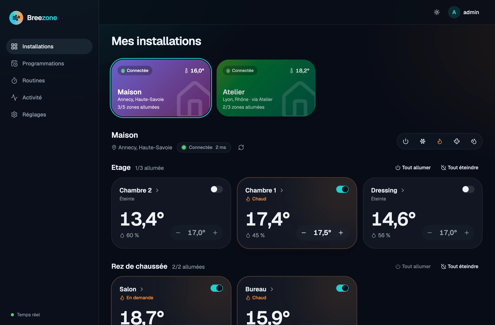

</picture>


|                                                                                |                                                                                         |
| ------------------------------------------------------------------------------ | --------------------------------------------------------------------------------------- |
| 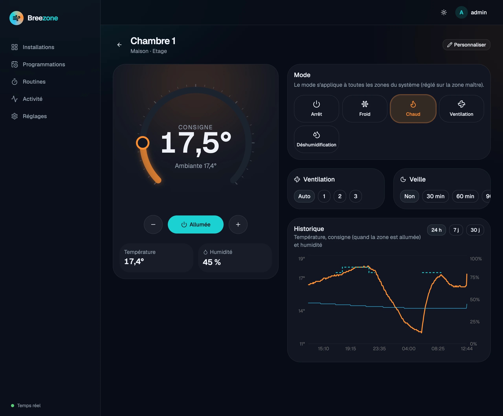 | 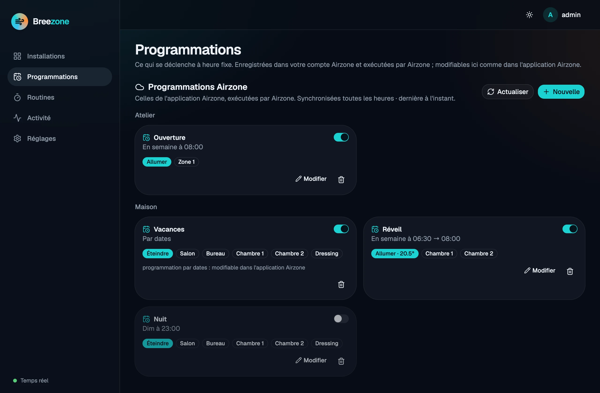                               |
| **Zone** : consigne, mode, ventilation, veille et historique                   | **Programmations** du compte Airzone, modifiables ici                                   |
| 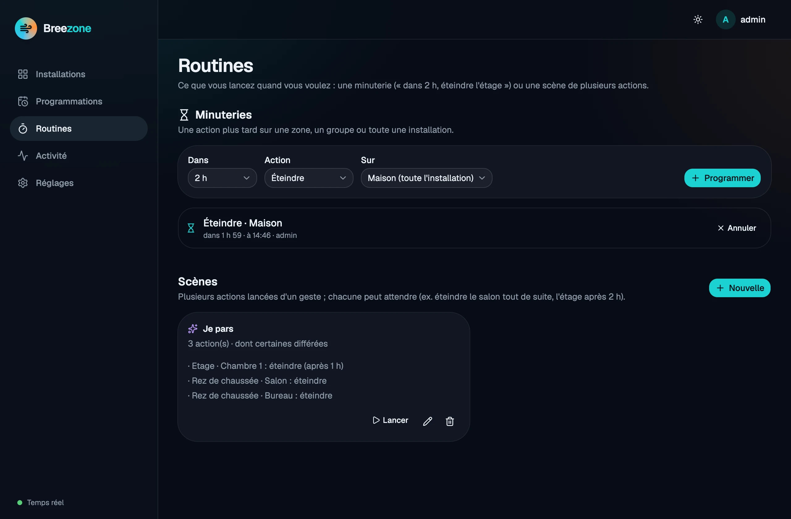              | 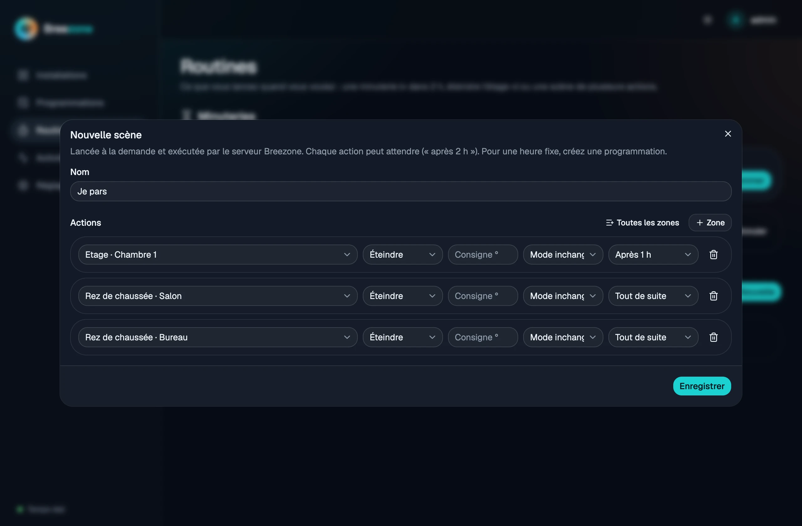                                  |
| **Routines** : minuteries et scènes                                            | **Scène** dont certaines actions attendent                                              |
| 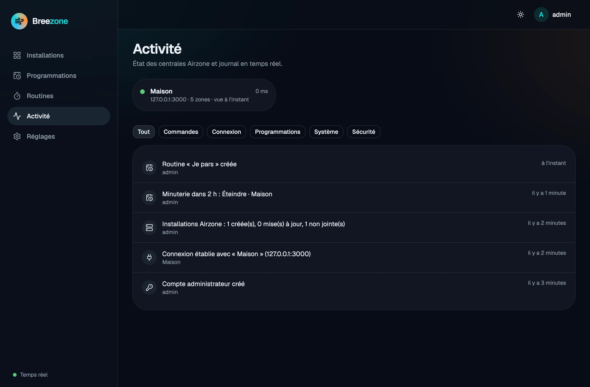                           | 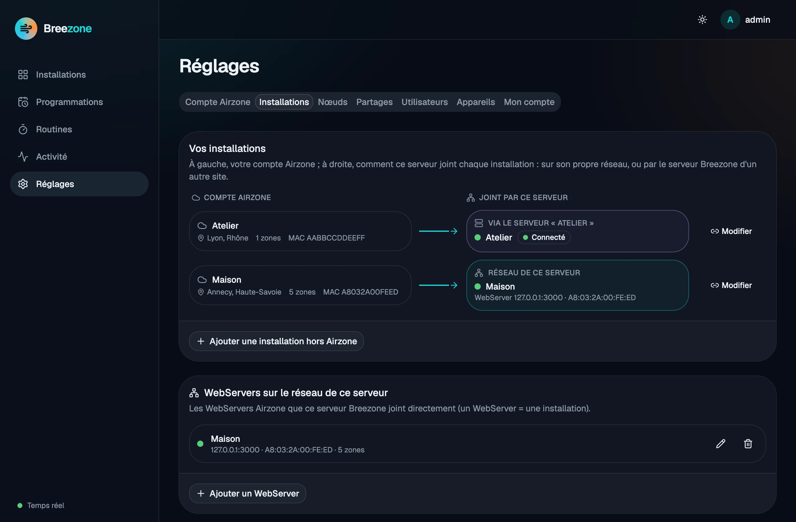 |
| **Activité** en temps réel                                                     | **Installations** : sur ce réseau ou via un autre site                                  |


### Application mobile


| Installations                                                                             | Zones par étage                                                                                                | Une zone                                                                                               | Programmations Airzone                                                                                            |
| :-----------------------------------------------------------------------------------------: | :--------------------------------------------------------------------------------------------------------------: | :------------------------------------------------------------------------------------------------------: | :-----------------------------------------------------------------------------------------------------------------: |
| 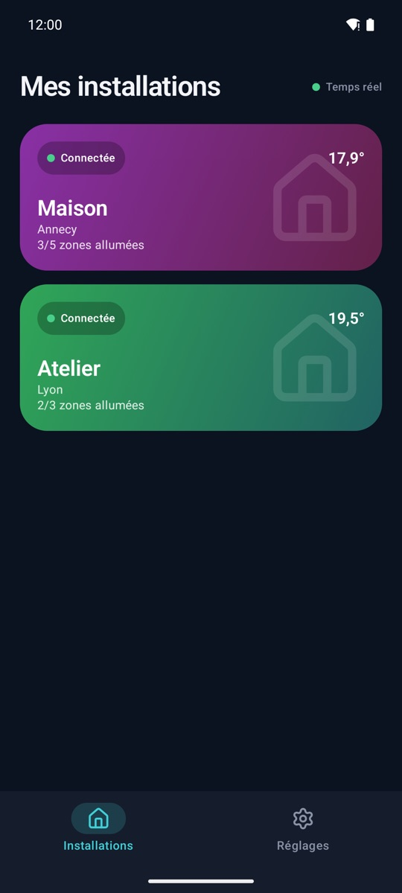 | 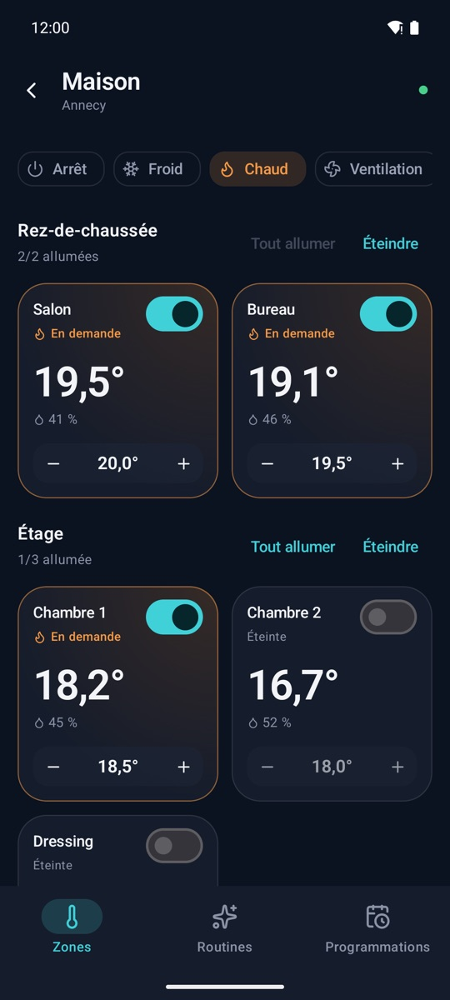 | 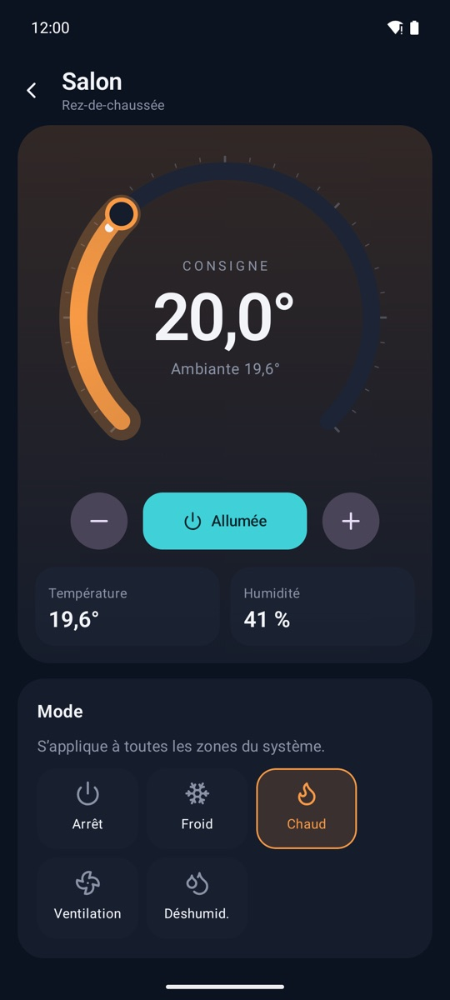 | 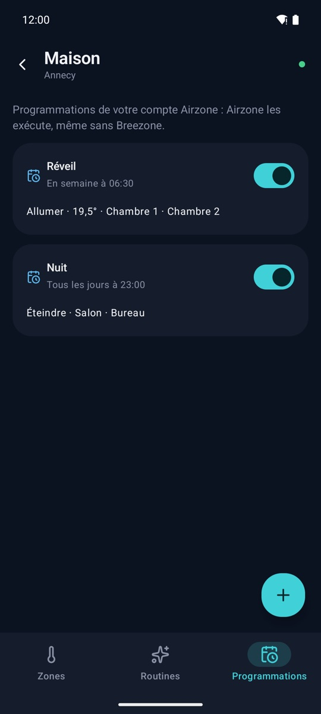 |


## Installation (Docker)

L'image est publiée sur GitHub Container Registry : `ghcr.io/emmanuelvinas/breezone`
(`linux/amd64` et `linux/arm64`). Tags : `latest`, la version (`0.6.1`) et la série (`0.6`).

Créez un dossier `breezone` contenant ce `docker-compose.yml`, puis lancez `docker compose up -d` :

```yaml
services:
  breezone:
    image: ghcr.io/emmanuelvinas/breezone:latest
    container_name: breezone
    restart: unless-stopped
    # Réseau de l'hôte (Linux) : Breezone trouve tout seul les WebServers du réseau local.
    network_mode: host
    environment:
      TZ: Europe/Paris
      # BREEZONE_PORT: "8427"   # si le port 8427 est déjà pris
    volumes:
      - breezone_data:/data
    mem_limit: 300m

volumes:
  breezone_data:
```

Ouvrez `http://<votre-serveur>:8427` : la première page crée le compte administrateur, puis propose
d'importer votre compte Airzone (facultatif) ou de rechercher les WebServers sur le réseau.

Sans compose :

```bash
docker run -d --name breezone --restart unless-stopped --network host \
  -v breezone_data:/data -e TZ=Europe/Paris ghcr.io/emmanuelvinas/breezone:latest
```

**NAS Synology** : guide pas à pas avec Container Manager :
[docs/install-synology.md](docs/install-synology.md).

**Réseau.** Le serveur doit joindre les WebServers (port 3000) de votre réseau. Sans `network_mode: host`
(Docker Desktop, réseau `bridge` avec `-p 8427:8427`), il ne peut pas deviner votre réseau local :
indiquez-le dans *Réglages › Installations* (ex. `192.168.1.0/24`) ou l'adresse IP du WebServer.

**Accès à distance sans VPN.** Utilisez un [Cloudflare Tunnel](https://developers.cloudflare.com/cloudflare-one/connections/connect-networks/) :
le [`docker-compose.yml` complet](docker-compose.yml) du dépôt contient un service `cloudflared` (profil
`tunnel`, jeton dans `.env` : `CLOUDFLARE_TUNNEL_TOKEN`). Aucun port n'est ouvert sur la box. N'exposez **jamais** le
port 3000 des WebServers : leur API n'a aucune authentification.

**Mise à jour.** `docker compose pull && docker compose up -d`. Pour rester sur une version précise,
remplacez `latest` par son numéro (ex. `0.6.1`). Les données (base SQLite, secret de
signature) sont dans le volume `breezone_data`. Sauvegarde :
`docker run --rm -v breezone_data:/data -v "$PWD":/backup alpine tar czf /backup/breezone.tgz -C /data .`

Les réglages (variables `BREEZONE_*`) sont décrits dans le [README anglais](README.md#settings) et
dans [`.env.sample`](.env.sample).

## Application mobile

Une application Android et iOS (français, anglais, espagnol) pour piloter vos installations depuis le
téléphone : zones, modes, routines et programmations  de chaque installation, temps réel,
plusieurs serveurs.

**Liens Google Play et App Store : bientôt disponibles.** En attendant, compilez-la depuis
[`mobile/`](mobile).

Saisissez l'adresse de votre serveur (`http://192.168.1.10:8427` à la maison, ou l'adresse `https://`
de votre tunnel) puis vos identifiants ; ajoutez un serveur par site. La session de l'appareil est
conservée dans l'Android Keystore / le Keychain iOS : le mot de passe n'est redemandé que s'il change ou
si l'appareil est révoqué depuis le web. Pas encore de serveur ? « Essayer la démo », sur le premier
écran, ouvre une maison simulée.

## Contribuer

Signalements, idées et pull requests sont les bienvenus : voir [CONTRIBUTING.md](CONTRIBUTING.md).
Essai sans matériel : `./scripts/run-local.sh --demo` lance un faux WebServer et un faux compte.  
Failles de sécurité : voir [SECURITY.md](SECURITY.md).

## Licence

[PolyForm Noncommercial 1.0.0](LICENSE.md) : vous pouvez utiliser, étudier, modifier et partager Breezone
pour tout usage **non commercial** (personnel, domestique, associatif, enseignement…). Tout usage
commercial — le vendre, l'intégrer à un produit ou service payant — nécessite un accord avec l'auteur.
Licence « source-available », non reconnue comme licence open source par l'OSI.