# Breezone

**Les appareils les plus courants de la maison dans une seule application simple : climatisation,
lumières, volets, énergie, panneaux solaires, recharge de voiture et ventilation. En local d'abord,
pour une maison ou plusieurs, sur le web et sur le téléphone.**

🌐 [breezone.cloud](https://breezone.cloud) · 🇬🇧 [Read in English](README.md)

## Pourquoi Breezone

Breezone, c'est la domotique pour ceux qui ne veulent pas *faire* de domotique. On ajoute un appareil,
ses pages sont prêtes : pas de YAML, pas de modèles, pas de tableau de bord à construire, pas de broker
à installer.

- **Simple.** Breezone trouve vos appareils sur le réseau ; on en ajoute un avec un bouton, un code ou
  une adresse. Chaque type d'appareil a sa page (climatisation, lumières, volets, énergie…), la même
  sur le web et sur le téléphone.
- **Les appareils courants, pas tous les appareils.** Breezone prend en charge les intégrations
  qu'on trouve dans la plupart des maisons (France et Europe d'abord), et dit non à celles qui sont
  rares ou compliquées à configurer. Il n'aura jamais autant d'intégrations que Home Assistant : ce
  n'est pas le but.
- **En local d'abord.** Les appareils sont pilotés sur le réseau de la maison, par leur API locale. Un
  compte dans le cloud ne sert que s'il reste simple et ponctuel (l'import du compte Airzone, par
  exemple), jamais pour piloter ce qui peut l'être en local.
- **Plusieurs sites.** Votre maison, celle de vos parents, une maison de vacances : chaque site a son
  petit serveur Breezone, et ils se relient **sans VPN** (invitation à usage unique, requêtes signées,
  lecture ou pilotage, révocable). L'interface web et l'application les montrent tous.
- **Léger.** Une image d'environ 20 Mo, quelques Mo de RAM : il tourne sur un NAS ou un Raspberry Pi.

Breezone est né en 2025, quand des fonctions de l'application Airzone jusque-là gratuites sont
passées sous abonnement payant
([Next.ink](https://next.ink/265416/airzone-withings-quand-des-fonctions-connectees-gratuites-deviennent-payantes/)),
alors que le WebServer Airzone dispose d'une API locale documentée. Il couvre aujourd'hui bien plus
que la climatisation.

## Appareils pris en charge

| Type | Marques et modèles | Comment |
| --- | --- | --- |
| Climatisation et chauffage | **Airzone** (WebServer) | API locale du WebServer ; compte Airzone facultatif (import, programmations) |
| Lumières | **Philips Hue** (pont) : lumières, pièces et scènes de l'application Hue | API locale du pont, ajouté avec son bouton |
| Volets, stores, fenêtres de toit | **Legrand** Home + Control (avec Netatmo), **VELUX** App Control (KIG 300), et les autres accessoires **HomeKit** | HomeKit, en local, appairé avec le code de l'accessoire ; appuis des télécommandes affichés |
| Prises, relais, compteurs d'énergie | **Shelly** Plus, Pro, Gen3 et Gen4 (Pro 3EM, Pro EM, relais, prises…) | API RPC locale, sans Shelly Cloud |
| Panneaux solaires | Micro-onduleurs **Hoymiles** (DTU Wi-Fi) | API locale du DTU : production par onduleur et par panneau |
| Recharge de voiture | **V2C Trydan** | API locale de la borne : marche, arrêt, courant, mode dynamique, verrou |
| Ventilation | **Renson Healthbox 3.0** | API locale : débit par pièce, boost, profils ; humidité, CO₂ et COV par pièce avec la clé API Renson |

**D'autres arrivent**, choisis pour leur popularité, leur accès local et leur simplicité d'ajout :
Matter, IKEA DIRIGERA, WiZ, TP-Link Tapo / Kasa, Tuya (en local), Somfy TaHoma, Enphase, Linky, bornes
OCPP, onduleurs Modbus SunSpec, caméras EZVIZ, arrosage du jardin… Il manque un appareil courant ?
Ouvrez une issue.

> Breezone est un projet indépendant, **sans lien avec aucun des fabricants ci-dessus**, ni approuvé
> ni soutenu par eux. Leurs noms et marques (Airzone, Philips Hue, Legrand, Netatmo, VELUX, Shelly,
> Hoymiles, V2C, Renson, HomeKit…) appartiennent à leurs propriétaires et ne sont cités que pour
> indiquer la compatibilité.

## Fonctions

- **Une page par type d'appareil** : climatisation (zones, consigne, mode, ventilation, veille,
  groupes), lumières (intensité, blanc, couleurs, scènes Hue), volets (ouvrir, fermer, position),
  énergie (la maison en ce moment, la journée, usage par usage), solaire (chaque panneau), recharge,
  ventilation.
- **Pièces** : les mêmes pièces pour tous les modules ; celles des applications Hue et Renson peuvent
  être reprises telles quelles.
- **Programmations** : celles de l'application Airzone, créées et modifiées depuis Breezone,
  exécutées par Airzone.
- **Routines** : scènes lancées à la demande et exécutées par votre serveur (chaque étape peut
  attendre : « éteindre le salon maintenant, les chambres dans 2 h »), et minuteries (« dans 2 h, tout
  éteindre »).
- **Historique** de chaque appareil et **journal d'activité** en temps réel, avec les erreurs du
  serveur expliquées.
- **Plusieurs sites sans VPN** : voir [Relier deux sites](docs/federation.md).
- **Utilisateurs et appareils** : administrateurs et utilisateurs ; chaque utilisateur ne voit que les
  installations qu'on lui donne, en lecture seule ou avec le pilotage ; sessions révocables par
  appareil.
- **Sauvegarde et déménagement** : export et import de la configuration (sans les secrets ni
  l'historique).

## Aperçu

### Interface web

<picture>

  <source media="(prefers-color-scheme: light)" srcset="docs/images/web/dashboard-light.webp">

  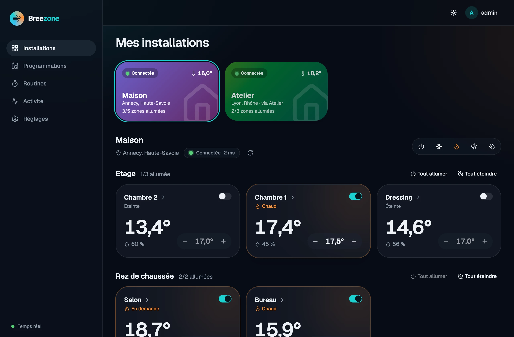

</picture>


|                                                                                |                                                                                         |
| ------------------------------------------------------------------------------ | --------------------------------------------------------------------------------------- |
| 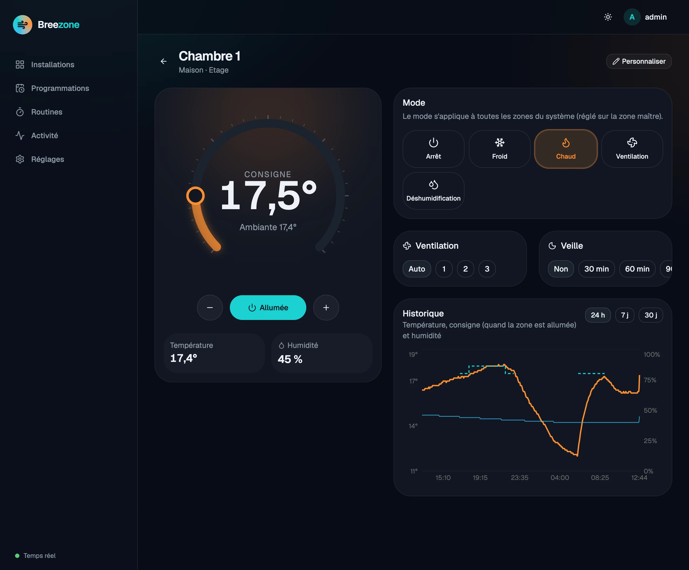 | 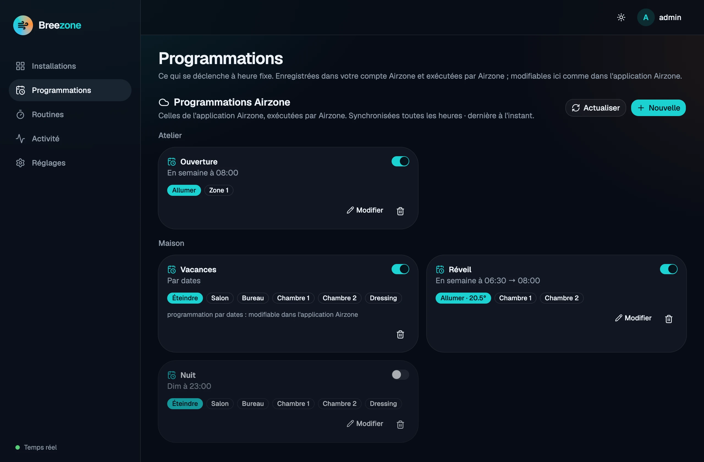                               |
| **Zone** : consigne, mode, ventilation, veille et historique                   | **Programmations** du compte Airzone, modifiables ici                                   |
| 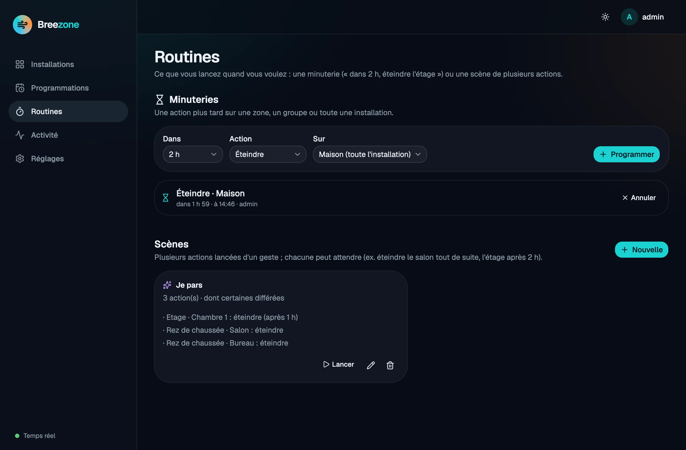              | 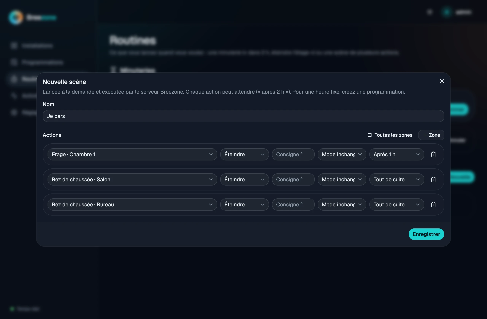                                  |
| **Routines** : minuteries et scènes                                            | **Scène** dont certaines actions attendent                                              |
| 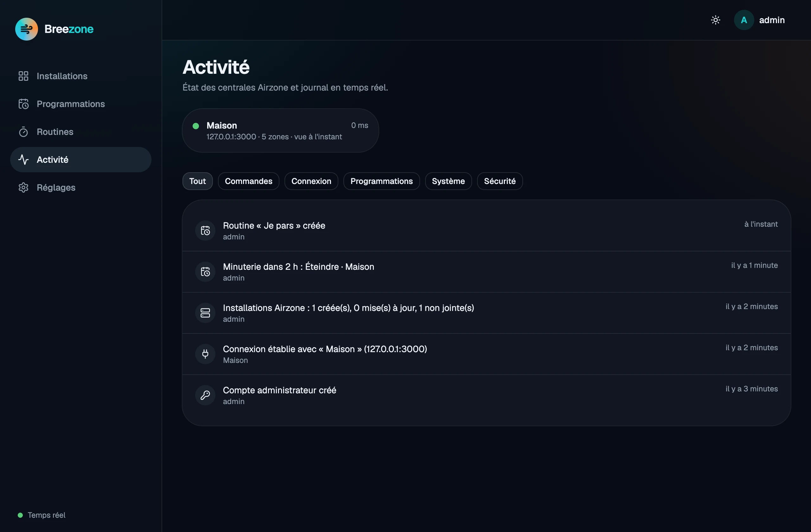                           | 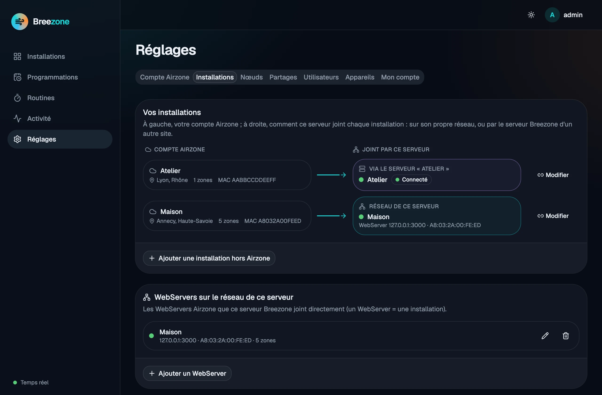 |
| **Activité** en temps réel                                                     | **Installations** : sur ce réseau ou via un autre site                                  |


### Application mobile


| Installations                                                                             | Zones par étage                                                                                                | Une zone                                                                                               | Programmations Airzone                                                                                            |
| :-----------------------------------------------------------------------------------------: | :--------------------------------------------------------------------------------------------------------------: | :------------------------------------------------------------------------------------------------------: | :-----------------------------------------------------------------------------------------------------------------: |
| 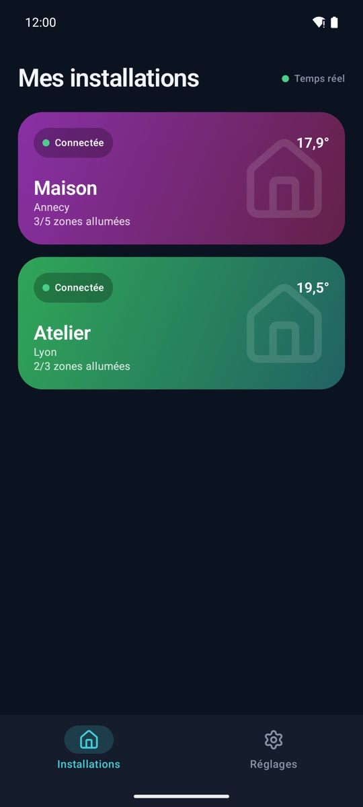 | 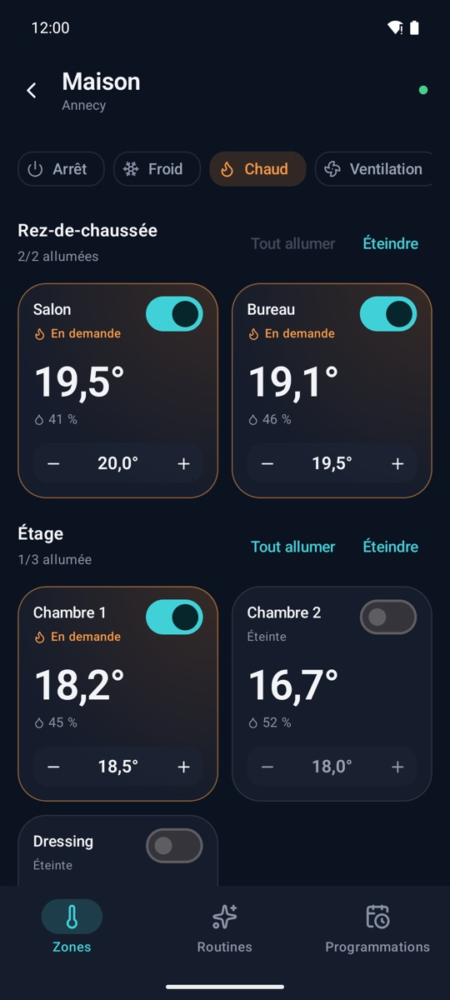 | 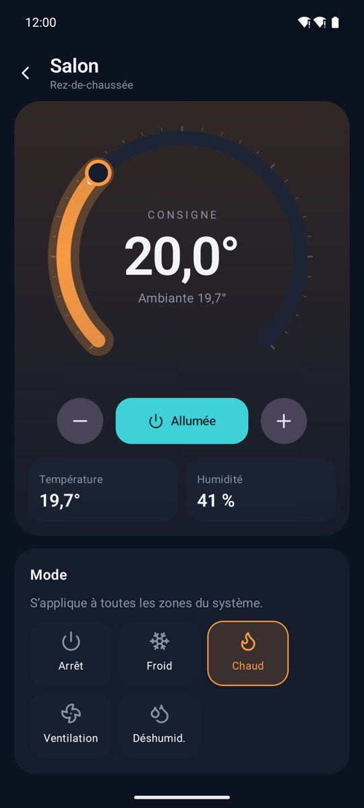 | 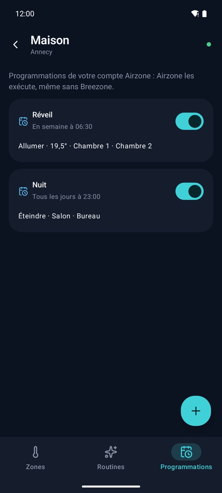 |


## Installation (Docker)

L'image est publiée sur GitHub Container Registry : `ghcr.io/emmanuelvinas/breezone`
(`linux/amd64` et `linux/arm64`). Tags : `latest`, la version (`0.9.1`) et la série (`0.9`).

Créez un dossier `breezone` contenant ce `docker-compose.yml`, puis lancez `docker compose up -d` :

```yaml
services:
  breezone:
    image: ghcr.io/emmanuelvinas/breezone:latest
    container_name: breezone
    restart: unless-stopped
    # Réseau de l'hôte (Linux) : Breezone trouve tout seul les WebServers du réseau local.
    network_mode: host
    environment:
      TZ: Europe/Paris
      # BREEZONE_PORT: "8427"   # si le port 8427 est déjà pris
    volumes:
      - breezone_data:/data
    mem_limit: 300m

volumes:
  breezone_data:
```

Ouvrez `http://<votre-serveur>:8427` : la première page crée le compte administrateur, puis propose
d'importer votre compte Airzone (facultatif) ou de rechercher les WebServers sur le réseau.

Sans compose :

```bash
docker run -d --name breezone --restart unless-stopped --network host \
  -v breezone_data:/data -e TZ=Europe/Paris ghcr.io/emmanuelvinas/breezone:latest
```

**NAS Synology** : guide pas à pas avec Container Manager :
[docs/install-synology.md](docs/install-synology.md).

**Réseau.** Le serveur doit joindre les WebServers (port 3000) de votre réseau. Sans `network_mode: host`
(Docker Desktop, réseau `bridge` avec `-p 8427:8427`), il ne peut pas deviner votre réseau local :
indiquez-le dans *Réglages › Installations* (ex. `192.168.1.0/24`) ou l'adresse IP du WebServer.

**Accès à distance sans VPN.** Utilisez un [Cloudflare Tunnel](https://developers.cloudflare.com/cloudflare-one/connections/connect-networks/) :
le [`docker-compose.yml` complet](docker-compose.yml) du dépôt contient un service `cloudflared` (profil
`tunnel`, jeton dans `.env` : `CLOUDFLARE_TUNNEL_TOKEN`). Aucun port n'est ouvert sur la box. N'exposez **jamais** le
port 3000 des WebServers : leur API n'a aucune authentification.

**Mise à jour.** `docker compose pull && docker compose up -d`. Pour rester sur une version précise,
remplacez `latest` par son numéro (ex. `0.9.1`). Les données (base SQLite, secret de
signature) sont dans le volume `breezone_data`. Sauvegarde :
`docker run --rm -v breezone_data:/data -v "$PWD":/backup alpine tar czf /backup/breezone.tgz -C /data .`

Les réglages (variables `BREEZONE_*`) sont décrits dans le [README anglais](README.md#settings) et
dans [`.env.sample`](.env.sample).

## Application mobile

Une application Android et iOS (français, anglais, espagnol) pour piloter vos maisons depuis le
téléphone : les mêmes pages que sur le web (climatisation, lumières, volets, énergie, solaire,
recharge, ventilation), routines et programmations, temps réel, plusieurs serveurs.

**Android : [Breezone sur Google Play](https://play.google.com/store/apps/details?id=com.breezone.app).** iOS : bientôt sur l'App Store ; en
attendant, compilez-la depuis [`mobile/`](mobile).

Saisissez l'adresse de votre serveur (`http://192.168.1.10:8427` à la maison, ou l'adresse `https://`
de votre tunnel) puis vos identifiants ; ajoutez un serveur par site. La session de l'appareil est
conservée dans l'Android Keystore / le Keychain iOS : le mot de passe n'est redemandé que s'il change ou
si l'appareil est révoqué depuis le web. Pas encore de serveur ? « Essayer la démo », sur le premier
écran, ouvre une maison simulée.

## Contribuer

Signalements, idées et pull requests sont les bienvenus : voir [CONTRIBUTING.md](CONTRIBUTING.md).
Essai sans matériel : `./scripts/run-local.sh --demo` lance un faux WebServer et un faux compte.  
Failles de sécurité : voir [SECURITY.md](SECURITY.md).

## Licence

[PolyForm Noncommercial 1.0.0](LICENSE.md) : vous pouvez utiliser, étudier, modifier et partager Breezone
pour tout usage **non commercial** (personnel, domestique, associatif, enseignement…). Tout usage
commercial — le vendre, l'intégrer à un produit ou service payant — nécessite un accord avec l'auteur.
Licence « source-available », non reconnue comme licence open source par l'OSI.