# Breezone

**The most common devices of your home in one simple app: air conditioning, lights, shutters,
energy, solar panels, EV charging and ventilation. Local first, for one home or several, on the web
and on your phone.**


🌐 [breezone.cloud](https://breezone.cloud) · 🇫🇷 [Lire en français](README.fr.md)

## Why Breezone

Breezone is home automation for people who do not want to *do* home automation. You add a device,
its pages are ready: no YAML, no templates, no dashboard to build, no broker to install.

- **Simple.** Breezone finds your devices on the network; you add one with a button, a code or an
  address. Each kind of device gets its own page (climate, lights, shutters, energy…), the same on
  the web and on the phone.
- **The common devices, not every device.** Breezone supports the integrations found in most homes
  (France and Europe first), and says no to niche or complicated ones. It will never have as many
  integrations as Home Assistant: that is not the goal.
- **Local first.** Devices are driven on your home network, through their local API. A cloud account
  is only used when it stays simple and occasional (importing your Airzone account, for instance),
  never to drive what can be driven locally.
- **Several sites.** Your home, your parents', a holiday home: each site runs its own small Breezone
  server, and they can be linked **without a VPN** (single-use invitation, signed requests, read-only
  or control, revocable). The web UI and the app show all of them.
- **Small.** One image of about 20 MB, a few MB of RAM: it runs on a NAS or a Raspberry Pi.

Breezone started in 2025, when features of the Airzone app that used to be free became part of a
paid subscription ([Next.ink, in French](https://next.ink/265416/airzone-withings-quand-des-fonctions-connectees-gratuites-deviennent-payantes/))
while the Airzone WebServer has a documented local API. It now covers much more than air
conditioning.

## Supported devices

| Kind | Brands and models | How |
| --- | --- | --- |
| Air conditioning and heating | **Airzone** (WebServer) | Local API of the WebServer; Airzone account optional (import, schedules) |
| Lights | **Philips Hue** (bridge): lights, rooms and scenes of the Hue app | Local API of the bridge, added with its button |
| Shutters, blinds, roof windows | **Legrand** Home + Control (with Netatmo), **VELUX** App Control (KIG 300), and other **HomeKit** accessories | HomeKit, locally, paired with the accessory's code; presses of remotes shown |
| Plugs, relays, energy meters | **Shelly** Plus, Pro, Gen3 and Gen4 (Pro 3EM, Pro EM, relays, plugs…) | Local RPC API, no Shelly Cloud |
| Solar panels | **Hoymiles** micro-inverters (Wi-Fi DTU) | Local API of the DTU: production per inverter and per panel |
| EV charging | **V2C Trydan** | Local API of the charger: start, stop, current, dynamic mode, lock |
| Ventilation | **Renson Healthbox 3.0** | Local API: air flow per room, boost, profiles; humidity, CO₂ and VOC per room with Renson's API key |

**More are coming**, chosen for how common, how local and how simple to add they are: Matter, IKEA
DIRIGERA, WiZ, TP-Link Tapo / Kasa, Tuya (local), Somfy TaHoma, Enphase, Linky, OCPP chargers,
Modbus SunSpec inverters, EZVIZ cameras, garden watering… A common device is missing? Open an issue.

> Breezone is an independent project, **not affiliated with, endorsed by or supported by** any of the
> manufacturers above. Their names and trademarks (Airzone, Philips Hue, Legrand, Netatmo, VELUX,
> Shelly, Hoymiles, V2C, Renson, HomeKit…) belong to their owners and are used only to describe
> compatibility.

## Features

- **A page per kind of device**: climate (zones, setpoint, mode, fan speed, sleep, groups), lights
  (brightness, white, colours, Hue scenes), shutters (open, close, position), energy (the home now,
  the day, use by use), solar (each panel), charging, ventilation.
- **Rooms**: the same rooms for every module; those of the Hue and Renson apps can be taken as they
  are.
- **Schedules**: the schedules of the Airzone app, created and edited from Breezone, run by Airzone.
- **Routines**: scenes started on demand, run by your server (each step can wait, e.g. "switch the
  living room off now, the bedrooms in 2 hours"), and timers ("in 2 hours, switch everything off").
- **History** of every device and a real-time **activity feed**, with the server's errors explained.
- **Several sites without VPN**: see [Linking two sites](docs/federation.md) (in French).
- **Users and devices**: administrators and users; each user only sees the installations given to
  them, read-only or with control; sessions revocable per device.
- **Backup and moving**: export and import of the configuration (without secrets or history).

## Screenshots

### Web UI

<picture>

  <source media="(prefers-color-scheme: light)" srcset="docs/images/web/dashboard-light.webp">

  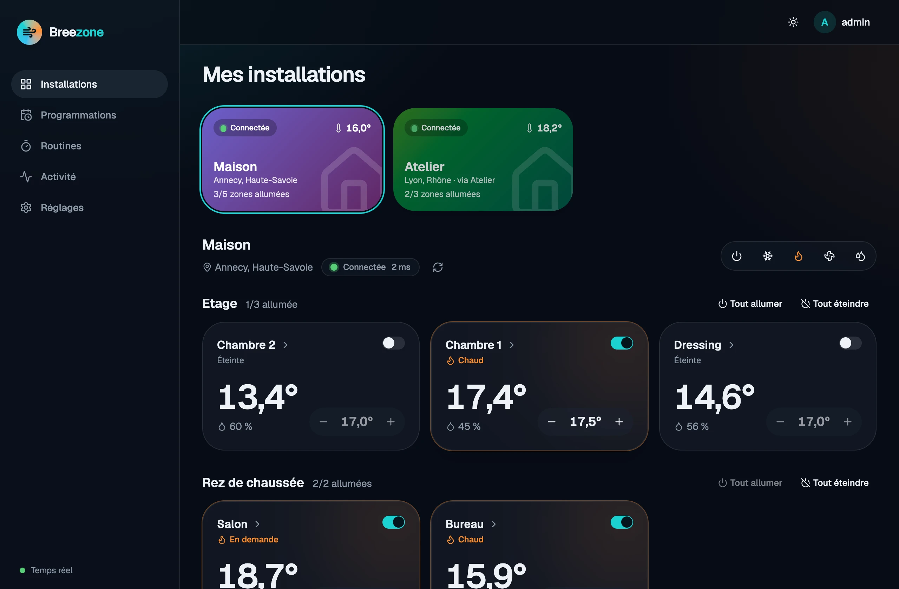

</picture>


|                                                                           |                                                                                           |
| ------------------------------------------------------------------------- | ----------------------------------------------------------------------------------------- |
| 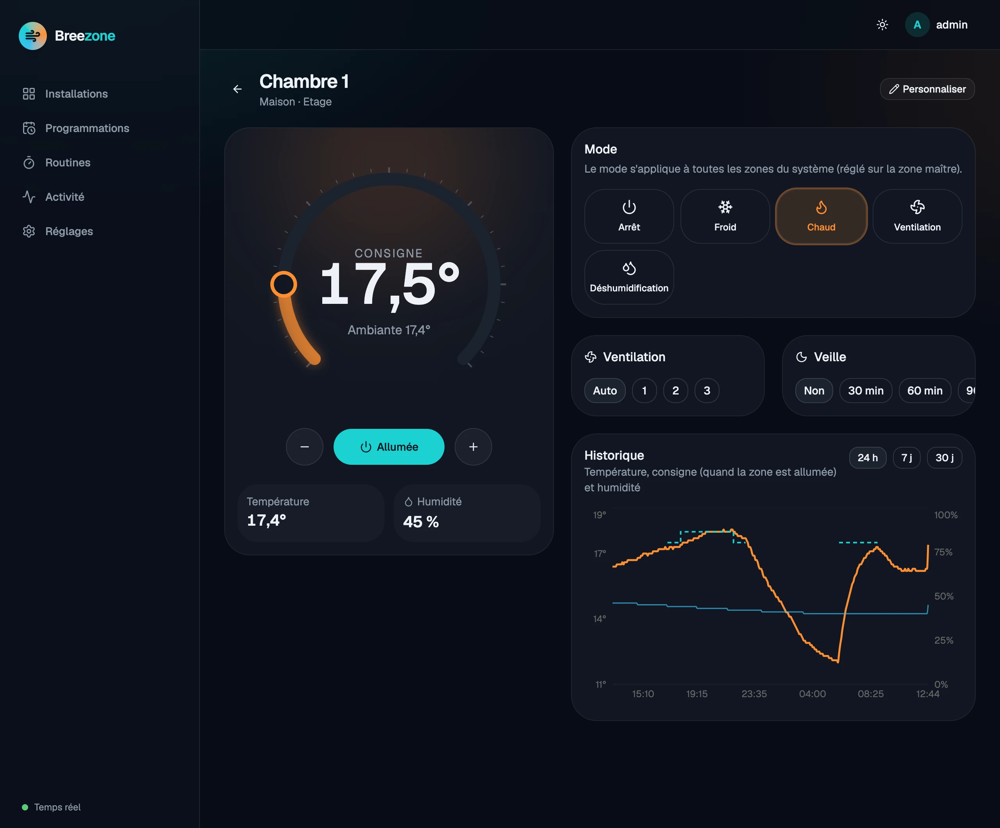 | 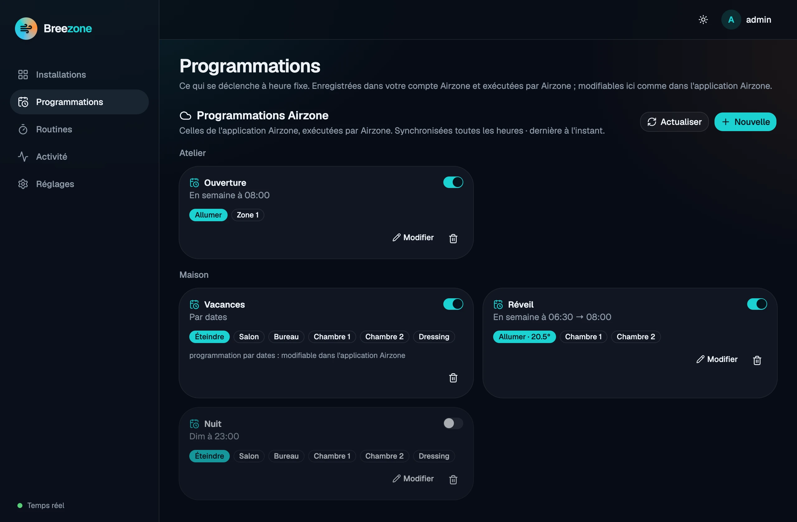                                      |
| **Zone**: setpoint, mode, fan speed, sleep and history                    | **Schedules** of the Airzone account, editable here                                       |
| 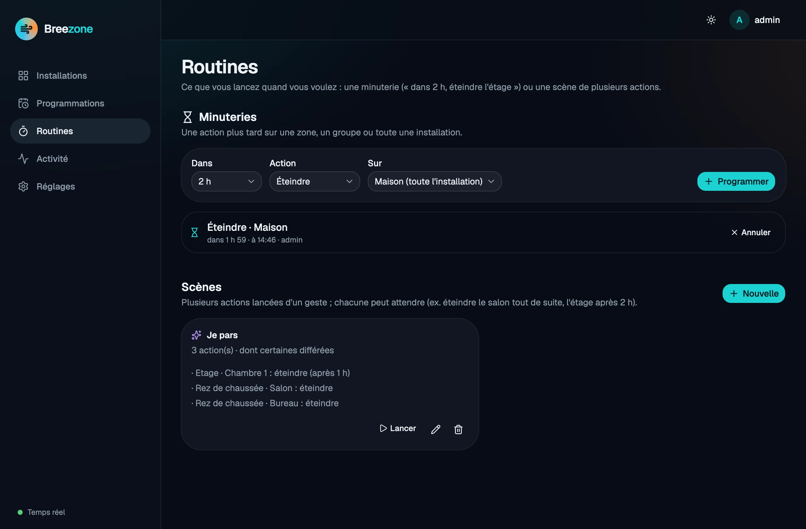             | 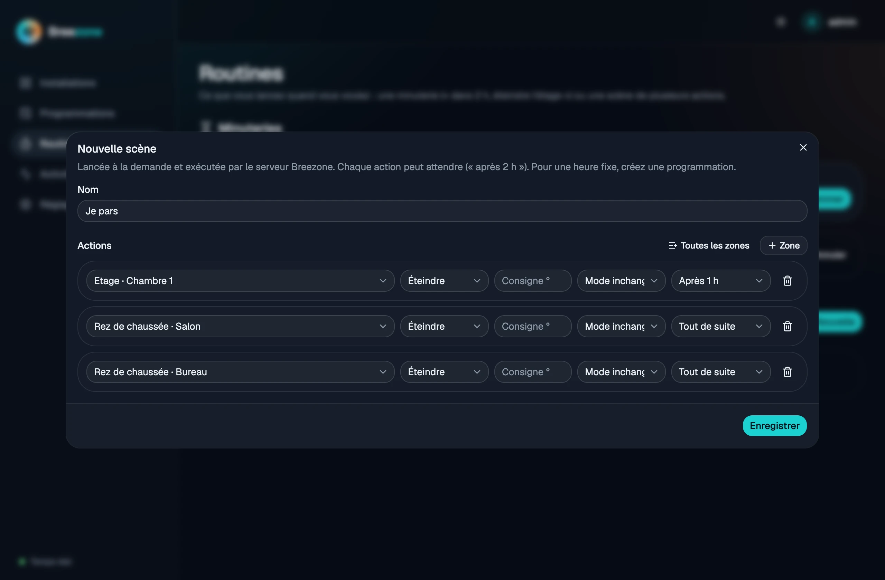                                        |
| **Routines**: timers and scenes                                           | **Scene** with delayed actions                                                            |
| 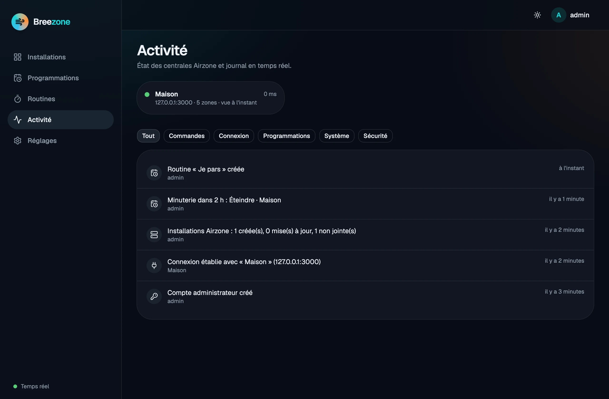                           | 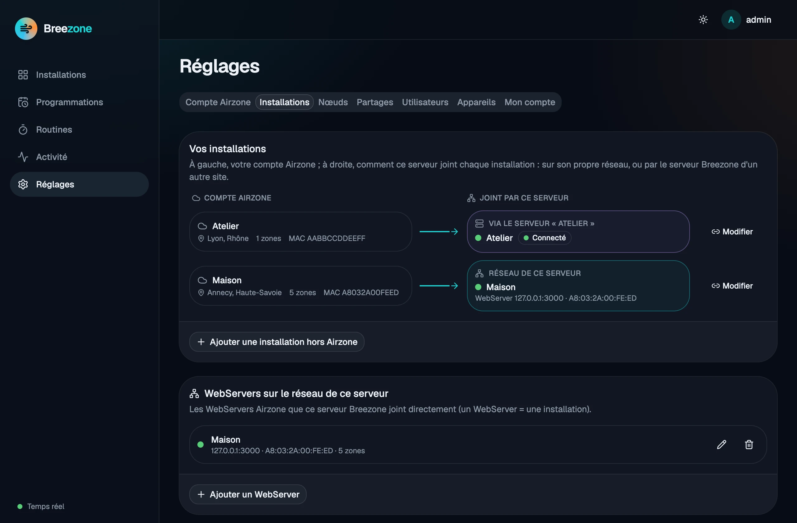 |
| Real-time **activity**                                                    | **Installations**: on this network or through another site                                |


The web UI is available in French, English and Spanish.

### Mobile app


| Installations                                                                              | Zones by floor                                                                                            | A zone                                                                                        | Airzone schedules                                                                                        |
| :------------------------------------------------------------------------------------------: | :---------------------------------------------------------------------------------------------------------: | :---------------------------------------------------------------------------------------------: | :--------------------------------------------------------------------------------------------------------: |
| 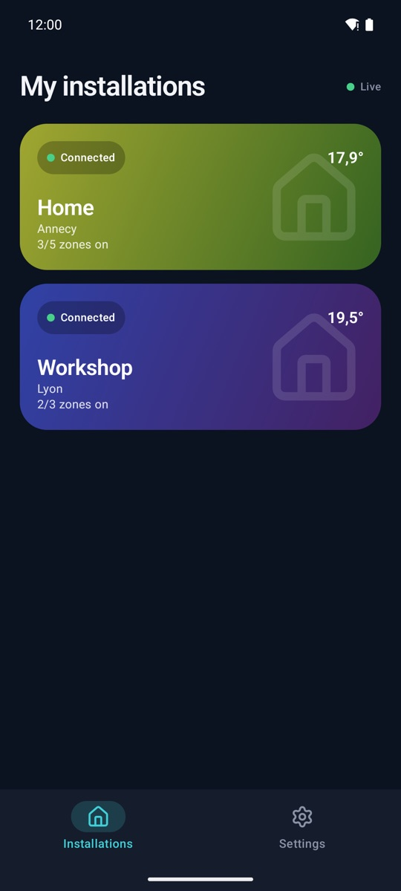 | 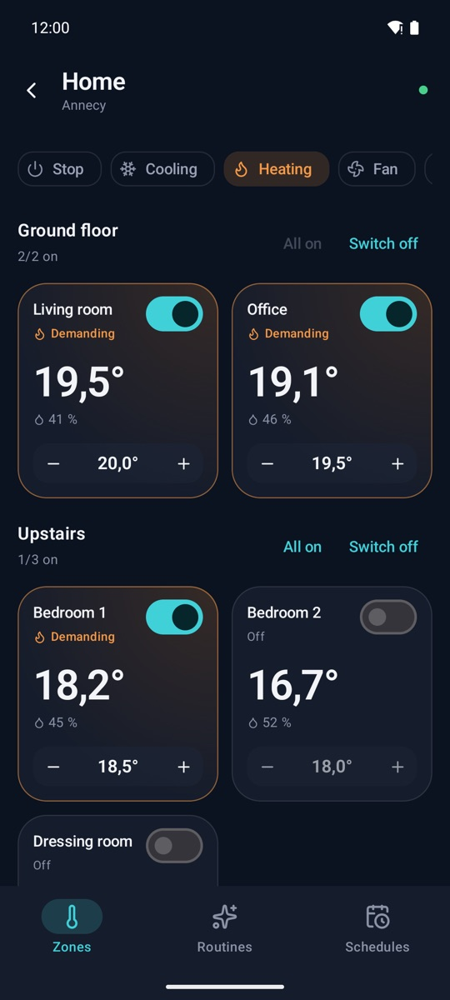 | 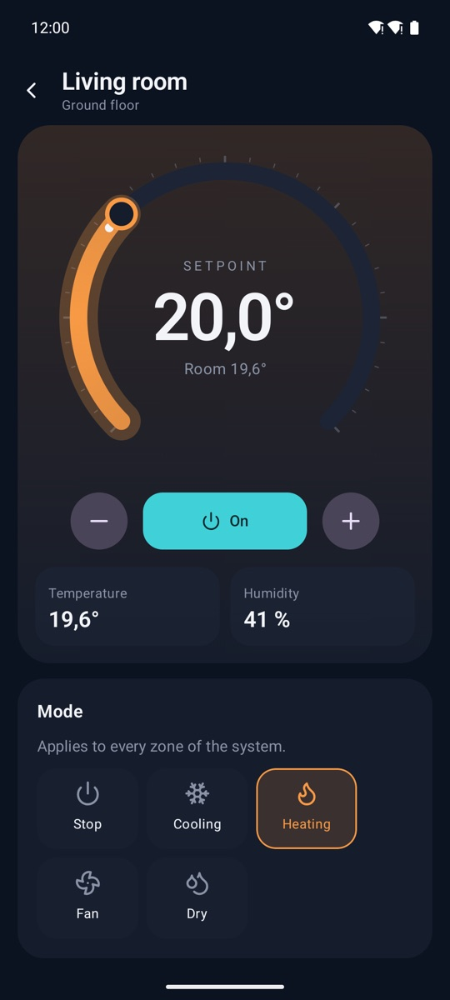 | 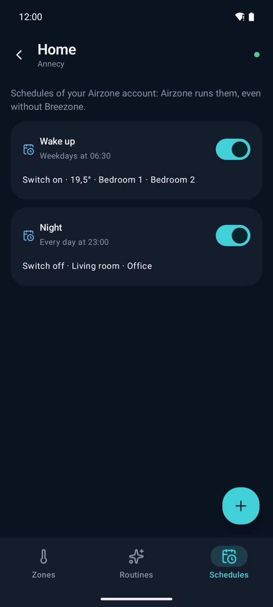 |


## Install (Docker)

The image is published on GitHub Container Registry: `ghcr.io/emmanuelvinas/breezone`
(`linux/amd64` and `linux/arm64`). Tags: `latest`, the version (`0.9.1`) and the minor line (`0.9`).

Create a `breezone` folder with this `docker-compose.yml`, then run `docker compose up -d`:

```yaml
services:
  breezone:
    image: ghcr.io/emmanuelvinas/breezone:latest
    container_name: breezone
    restart: unless-stopped
    # Host network (Linux): Breezone finds the WebServers of your LAN by itself.
    network_mode: host
    environment:
      TZ: Europe/Paris
      # BREEZONE_PORT: "8427"   # if port 8427 is already taken
    volumes:
      - breezone_data:/data
    mem_limit: 300m

volumes:
  breezone_data:
```

Open `http://<your-server>:8427`: the first page creates the administrator account, then offers to
import your Airzone account (optional) or to search for WebServers on the network.

Without compose:

```bash
docker run -d --name breezone --restart unless-stopped --network host \
  -v breezone_data:/data -e TZ=Europe/Paris ghcr.io/emmanuelvinas/breezone:latest
```

**Synology NAS**: step-by-step guide with Container Manager, in French:
[docs/install-synology.md](docs/install-synology.md).

**Network.** The server must reach the WebServers (port 3000) on your LAN. Without `network_mode: host`
(Docker Desktop, `bridge` network with `-p 8427:8427`) it cannot guess your LAN: set it in
*Settings › Installations* (e.g. `192.168.1.0/24`) or give the WebServer's IP address.

**Remote access without VPN.** Use a [Cloudflare Tunnel](https://developers.cloudflare.com/cloudflare-one/connections/connect-networks/):
the repository's [full `docker-compose.yml`](docker-compose.yml) has a `cloudflared` service (`tunnel`
profile, token in `.env`: `CLOUDFLARE_TUNNEL_TOKEN`). No port is opened on your router. **Never** expose port
3000 of the WebServers: their API has no authentication.

**Update.** `docker compose pull && docker compose up -d`. To stay on a given version, replace
`latest` with its number (e.g. `0.9.1`). Data (SQLite database, signing secret, `data.key`: the key of the stored passwords and
pairings, to keep with the database) is in the `breezone_data` volume; back it up with
`docker run --rm -v breezone_data:/data -v "$PWD":/backup alpine tar czf /backup/breezone.tgz -C /data .`

### Settings


| Variable                                                             | Default                         | Purpose                                                                             |
| -------------------------------------------------------------------- | ------------------------------- | ----------------------------------------------------------------------------------- |
| `BREEZONE_HTTP_PORT`                                                 | `8427`                          | Published port (compose)                                                            |
| `BREEZONE_VERSION`                                                   | `latest`                        | Image tag (compose)                                                                 |
| `BREEZONE_SCAN_SUBNET`                                               | server's /24                    | Network scanned for WebServers (also settable in the UI)                            |
| `BREEZONE_AIRZONE_HOSTS`                                             | —                               | Installations created at first start (`Home=192.168.1.25,Office=192.168.1.40:3000`) |
| `BREEZONE_ADMIN_USER` / `BREEZONE_ADMIN_PASSWORD`                    | —                               | Administrator created at first start (otherwise from the web page)                  |
| `BREEZONE_POLL_INTERVAL_SECS`                                        | `15`                            | WebServer polling period                                                            |
| `BREEZONE_DEVICE_READ_MS`                                            | `5000`                          | Reading period of the device sources (Shelly…)                                      |
| `BREEZONE_HISTORY_RETENTION_DAYS` / `BREEZONE_EVENTS_RETENTION_DAYS` | `90` / `30`                     | Retention                                                                           |
| `BREEZONE_ACCESS_TOKEN_TTL_SECS` / `BREEZONE_REFRESH_TOKEN_TTL_DAYS` | `900` / `60`                    | Token lifetimes (device sessions are sliding)                                       |
| `BREEZONE_JWT_SECRET`                                                | generated in `/data/jwt.secret` | Signing secret                                                                      |
| `TZ`                                                                 | `Europe/Paris`                  | Time zone                                                                           |
| `RUST_LOG`                                                           | `info,…`                        | Log level                                                                           |


## Mobile app

An Android and iOS app (English, French, Spanish) to drive your homes from your phone: the same pages
as the web (climate, lights, shutters, energy, solar, charging, ventilation), routines and schedules,
live updates, several servers.

**Android: [Breezone on Google Play](https://play.google.com/store/apps/details?id=com.breezone.app).** iOS: coming soon
on the App Store; until then, build it yourself from [`mobile/`](mobile).

Add your server's address (`http://192.168.1.10:8427` at home, or your tunnel's `https://` address)
and sign in; add one server per site. The device session is kept in the Android Keystore / iOS
Keychain: you sign in again only if it changes or if the device is revoked from the web UI. No server
yet? « Try the demo » on the first screen opens a simulated home.

## How it works

```
 Airzone WebServers  ─┐
 Hue, Shelly, Trydan  ├─(local APIs, LAN)── Breezone server ──(REST + WebSocket)── mobile app
 Hoymiles, Renson     │                      Rust · SQLite                         web UI (served by the server)
 HomeKit accessories ─┘                       ├─ other Breezone servers (federation, HTTPS)
                                              └─ Airzone Cloud (optional: import, schedules)
```


| Folder                               | Content                                                                                                                       |
| ------------------------------------ | ----------------------------------------------------------------------------------------------------------------------------- |
| [`server/`](server)                  | Rust server (axum, sqlx/SQLite): API, Airzone polling, device drivers (Hue, HomeKit, Shelly, Hoymiles, Trydan, Renson), routines, timers, auth, federation, a fake Airzone for demos and tests |
| [`web/`](web)                        | Web UI: React 19, Vite, Tailwind 4, shadcn/ui                                                                                 |
| [`mobile/`](mobile)                  | Compose Multiplatform app (Android and iOS)                                                                                   |
| [`docs/API.md`](docs/API.md)         | API reference (in French)                                                                                                     |


Airzone APIs used:

- **Local** (WebServer, port 3000): `POST /api/v1/hvac` to read, `PUT /api/v1/hvac` to write,
`POST /api/v1/webserver`. The mode can only be written on the master zone of a system; Breezone
handles it.
- **Airzone Cloud** (optional, with your account): import of the organisation (read-only) and the
schedules of the Airzone app (the local API has none).

Thanks to [`aioairzone`](https://github.com/Noltari/aioairzone) and
[`aioairzone-cloud`](https://github.com/Noltari/aioairzone-cloud) for documenting these APIs.

## Contributing

Bug reports, ideas and pull requests are welcome: see [CONTRIBUTING.md](CONTRIBUTING.md). Try it
without hardware: `./scripts/run-local.sh --demo` starts a fake Airzone WebServer and a fake 
Cloud. Security issues: see [SECURITY.md](SECURITY.md).

## License

[PolyForm Noncommercial 1.0.0](LICENSE.md): you may use, study, modify and share Breezone for any
**noncommercial** purpose (personal use, home, associations, education…). Commercial use — selling it,
including it in a paid product or service — requires a separate agreement with the author.
This is a *source-available* license, not an OSI-approved open-source license.