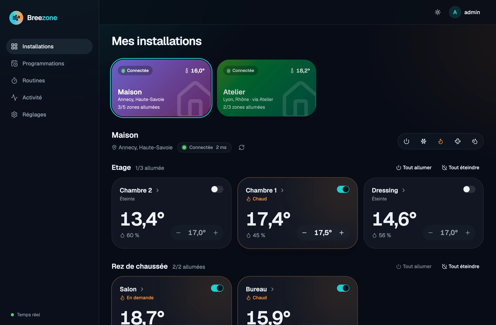
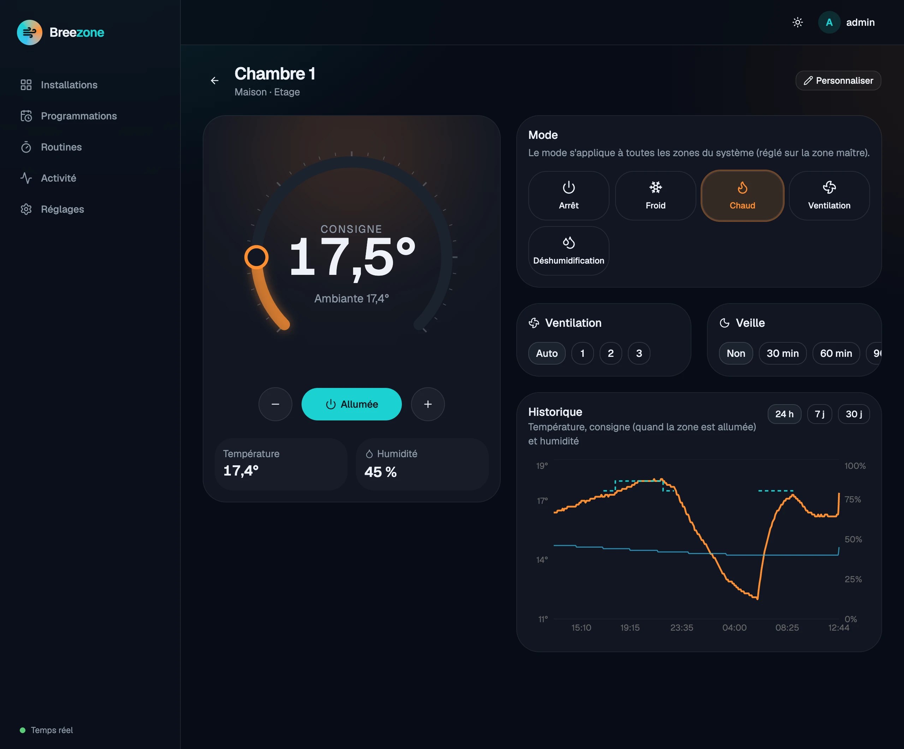
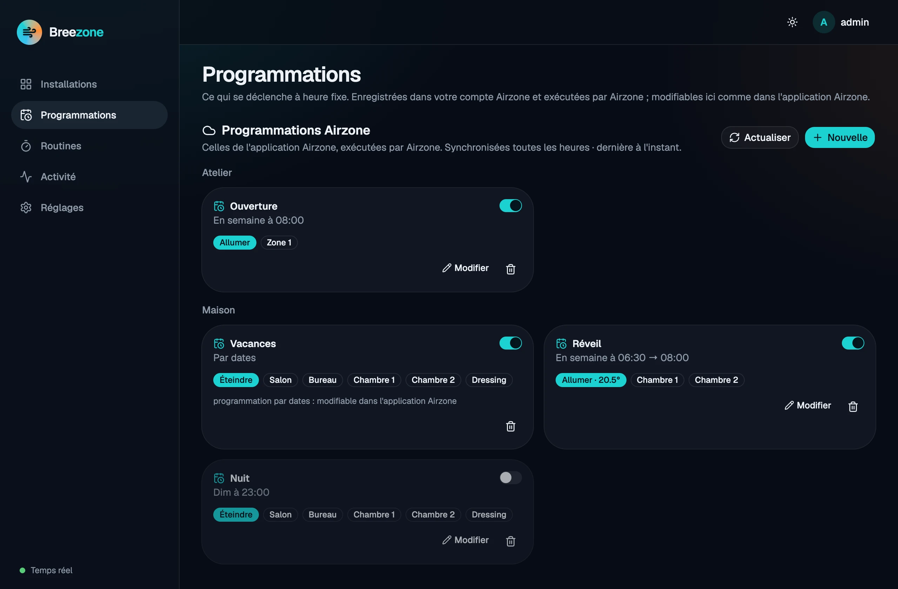
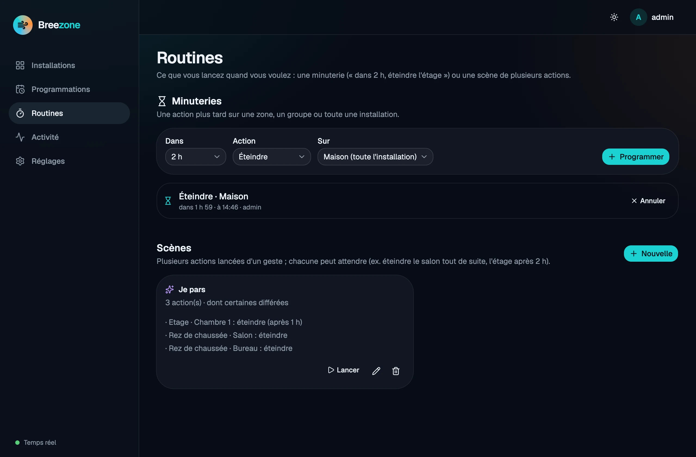
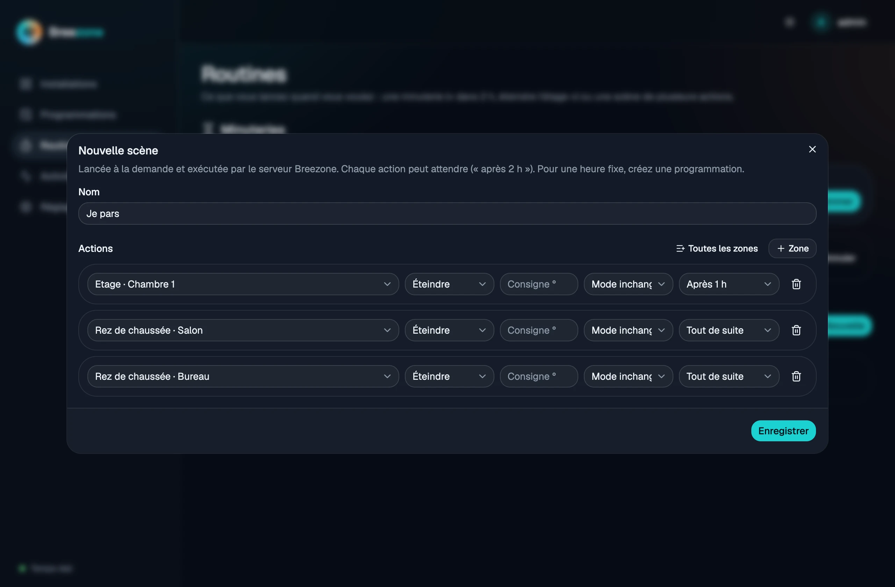
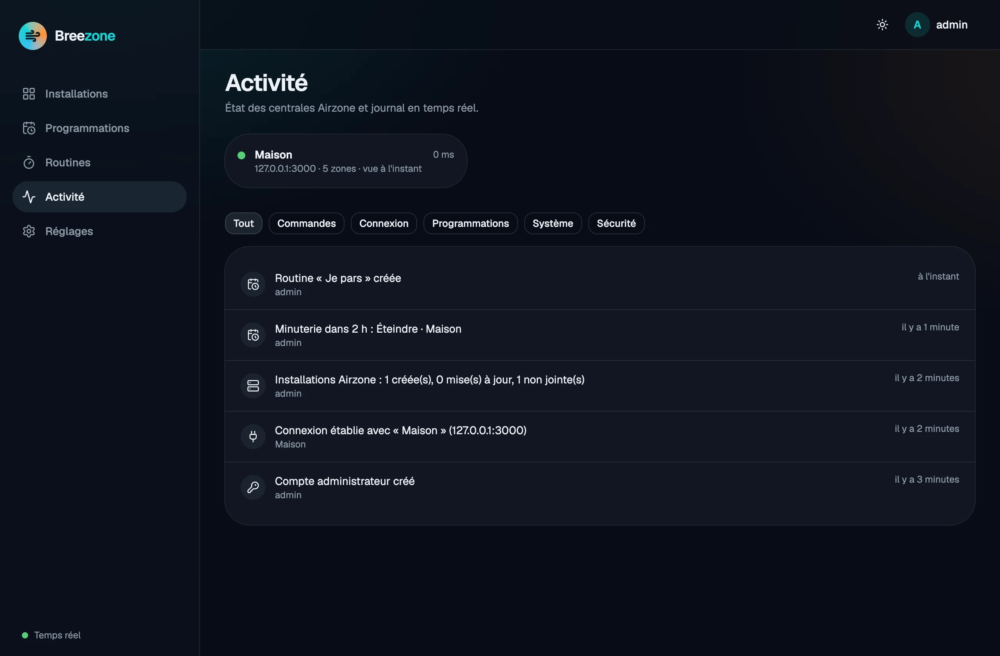
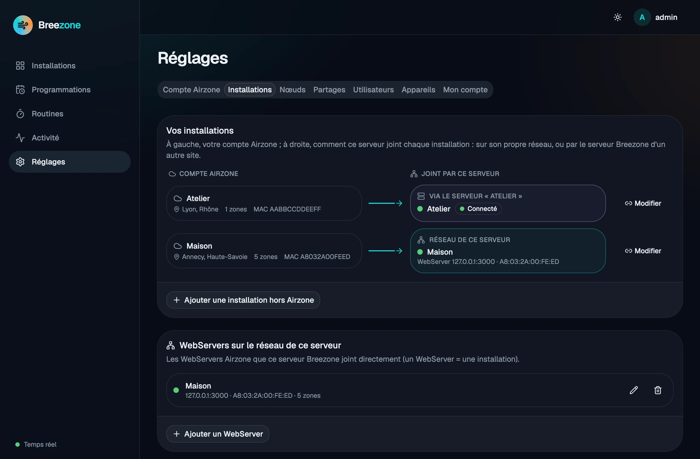

# Breezone

**Control your Airzone heating and air conditioning locally. No cloud required.**

[](https://github.com/EmmanuelVinas/breezone/actions/workflows/ci.yml)
[](LICENSE.md)
[](https://github.com/EmmanuelVinas/breezone/pkgs/container/breezone)

🌐 [breezone.cloud](https://breezone.cloud) · 🇫🇷 [Lire en français](README.fr.md)

In 2025, features of the Airzone app that used to be free (routines, some remote features…) became
part of a paid subscription ([Next.ink, in French](https://next.ink/265416/airzone-withings-quand-des-fonctions-connectees-gratuites-deviennent-payantes/)).
Your Airzone WebServer, however, has a documented **local API** on your network. Breezone is a small
self-hosted server that talks to it, with a web UI and an Android / iOS app.

> Breezone is an independent project. It is **not affiliated with, endorsed by or supported by
> Airzone** (Corporación Empresarial Altra S.L.). "Airzone" is a trademark of its owner, used here only
> to describe compatibility.

<picture>
  <source media="(prefers-color-scheme: light)" srcset="docs/images/web/dashboard-light.webp">
  
</picture>

## Features

- **Zones**: on/off, setpoint, mode (heat, cool, fan, dry, auto), fan speed, sleep; groups (floors)
  with group on/off.
- **Schedules**: the schedules of the Airzone app, created and edited from Breezone, run by Airzone.
- **Routines**: scenes started on demand, run by your server (each step can wait, e.g. "switch the
  living room off now, the bedrooms in 2 hours"), and timers ("in 2 hours, switch everything off").
- **History** (temperature, setpoint, humidity) and a real-time **activity feed**.
- **Several sites without VPN**: each site runs its own Breezone; a server can share some of its
  installations with another one (single-use invitation, approval, signed requests, read-only or
  control, revocable) — see [Linking two sites](docs/federation.md) (in French).
- **Users and devices**: administrators and users; each user only sees the installations given to
  them, read-only or with control; sessions revocable per device.
- **Optional Airzone account import** (read-only): installation names, city, zone groups; WebServers
  are found on the network by their MAC address.
- **Tiny**: one ~20 MB image, a few MB of RAM — fits on any NAS or Raspberry Pi.

## Screenshots

| | |
|---|---|
|  |  |
| **Zone**: setpoint, mode, fan speed, sleep and history | **Schedules** of the Airzone account, editable here |
|  |  |
| **Routines**: timers and scenes | **Scene** with delayed actions |
|  |  |
| Real-time **activity** | **Installations**: on this network or through another site |

The web UI is in French for now; English is on the [roadmap](docs/ROADMAP.md).

## Install (Docker)

The image is published on GitHub Container Registry: `ghcr.io/emmanuelvinas/breezone`
(`linux/amd64` and `linux/arm64`). Tags: `latest`, the version (`0.5.0`) and the minor line (`0.5`).

Create a `breezone` folder with this `docker-compose.yml`, then run `docker compose up -d`:

```yaml
services:
  breezone:
    image: ghcr.io/emmanuelvinas/breezone:latest
    container_name: breezone
    restart: unless-stopped
    # Host network (Linux): Breezone finds the WebServers of your LAN by itself.
    network_mode: host
    environment:
      TZ: Europe/Paris
      # BREEZONE_PORT: "8427"   # if port 8427 is already taken
    volumes:
      - breezone_data:/data
    mem_limit: 300m

volumes:
  breezone_data:
```

Open `http://<your-server>:8427`: the first page creates the administrator account, then offers to
import your Airzone account (optional) or to search for WebServers on the network.

Without compose:

```bash
docker run -d --name breezone --restart unless-stopped --network host \
  -v breezone_data:/data -e TZ=Europe/Paris ghcr.io/emmanuelvinas/breezone:latest
```

**Synology NAS**: step-by-step guide with Container Manager, in French:
[docs/install-synology.md](docs/install-synology.md).

**Network.** The server must reach the WebServers (port 3000) on your LAN. Without `network_mode: host`
(Docker Desktop, `bridge` network with `-p 8427:8427`) it cannot guess your LAN: set it in
*Settings › Installations* (e.g. `192.168.1.0/24`) or give the WebServer's IP address.

**Remote access without VPN.** Use a [Cloudflare Tunnel](https://developers.cloudflare.com/cloudflare-one/connections/connect-networks/):
the repository's [full `docker-compose.yml`](docker-compose.yml) has a `cloudflared` service (`tunnel`
profile, token in `.env`: `CLOUDFLARE_TUNNEL_TOKEN`). No port is opened on your router. **Never** expose port
3000 of the WebServers: their API has no authentication.

**Update.** `docker compose pull && docker compose up -d`. To stay on a given version, replace
`latest` with its number (e.g. `0.5.0`). Data (SQLite database, signing secret) is
in the `breezone_data` volume; back it up with
`docker run --rm -v breezone_data:/data -v "$PWD":/backup alpine tar czf /backup/breezone.tgz -C /data .`

### Settings

| Variable | Default | Purpose |
|----------|---------|---------|
| `BREEZONE_HTTP_PORT` | `8427` | Published port (compose) |
| `BREEZONE_VERSION` | `latest` | Image tag (compose) |
| `BREEZONE_SCAN_SUBNET` | server's /24 | Network scanned for WebServers (also settable in the UI) |
| `BREEZONE_AIRZONE_HOSTS` | — | Installations created at first start (`Home=192.168.1.25,Office=192.168.1.40:3000`) |
| `BREEZONE_ADMIN_USER` / `BREEZONE_ADMIN_PASSWORD` | — | Administrator created at first start (otherwise from the web page) |
| `BREEZONE_POLL_INTERVAL_SECS` | `15` | WebServer polling period |
| `BREEZONE_HISTORY_RETENTION_DAYS` / `BREEZONE_EVENTS_RETENTION_DAYS` | `90` / `30` | Retention |
| `BREEZONE_ACCESS_TOKEN_TTL_SECS` / `BREEZONE_REFRESH_TOKEN_TTL_DAYS` | `900` / `365` | Token lifetimes (device sessions are sliding) |
| `BREEZONE_JWT_SECRET` | generated in `/data/jwt.secret` | Signing secret |
| `TZ` | `Europe/Paris` | Time zone |
| `RUST_LOG` | `info,…` | Log level |

## Mobile app

Android: Google Play (coming soon) or build it yourself. Add your server's address
(`http://192.168.1.10:8427` at home, or your tunnel's `https://` address) and sign in; add one server
per site. The device session is kept in the Android Keystore / iOS Keychain: you sign in again only if
it changes or if the device is revoked from the web UI.

## How it works

```
 Airzone WebServers ──(local API :3000, LAN)── Breezone server ──(REST + WebSocket)── mobile app
                                                Rust · SQLite                         web UI (served by the server)
                                                 ├─ other Breezone servers (federation, HTTPS)
                                                 └─ Airzone Cloud (optional: import, schedules)
```

| Folder | Content |
|--------|---------|
| [`server/`](server) | Rust server (axum, sqlx/SQLite): API, Airzone polling, routines, timers, auth, federation, a fake Airzone for demos and tests |
| [`web/`](web) | Web UI: React 19, Vite, Tailwind 4, shadcn/ui |
| [`mobile/`](mobile) | Compose Multiplatform app (Android and iOS) |
| [`docs/API.md`](docs/API.md) | API reference (in French) |
| [`docs/ROADMAP.md`](docs/ROADMAP.md) | Roadmap (in French) |

Airzone APIs used:

- **Local** (WebServer, port 3000): `POST /api/v1/hvac` to read, `PUT /api/v1/hvac` to write,
  `POST /api/v1/webserver`. The mode can only be written on the master zone of a system; Breezone
  handles it.
- **Airzone Cloud** (optional, with your account): import of the organisation (read-only) and the
  schedules of the Airzone app (the local API has none).

Thanks to [`aioairzone`](https://github.com/Noltari/aioairzone) and
[`aioairzone-cloud`](https://github.com/Noltari/aioairzone-cloud) for documenting these APIs.

## Contributing

Bug reports, ideas and pull requests are welcome: see [CONTRIBUTING.md](CONTRIBUTING.md). Try it
without hardware: `./scripts/run-local.sh --demo` starts a fake Airzone WebServer and a fake Airzone
Cloud. Security issues: see [SECURITY.md](SECURITY.md).

## License

[PolyForm Noncommercial 1.0.0](LICENSE.md): you may use, study, modify and share Breezone for any
**noncommercial** purpose (personal use, home, associations, education…). Commercial use — selling it,
including it in a paid product or service — requires a separate agreement with the author.
This is a *source-available* license, not an OSI-approved open-source license.
