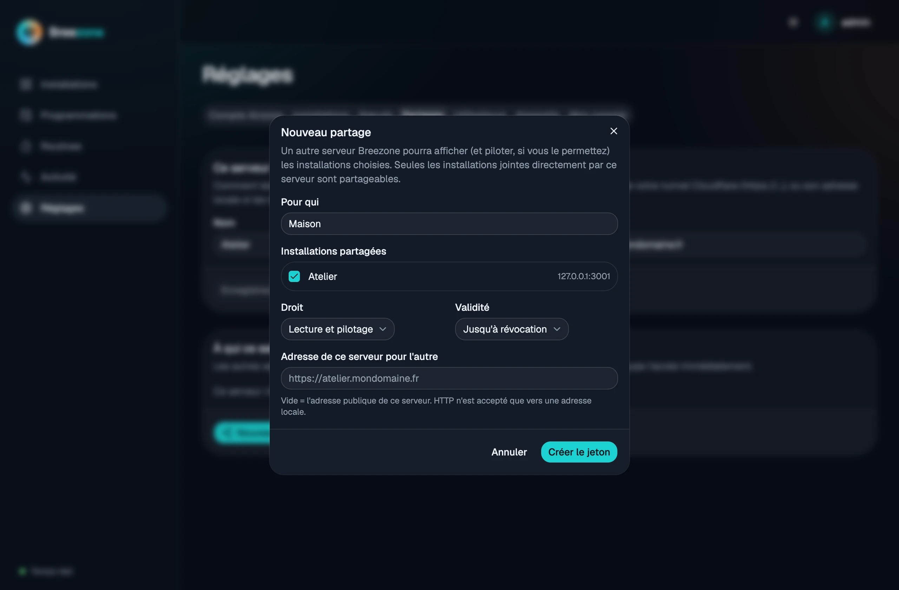
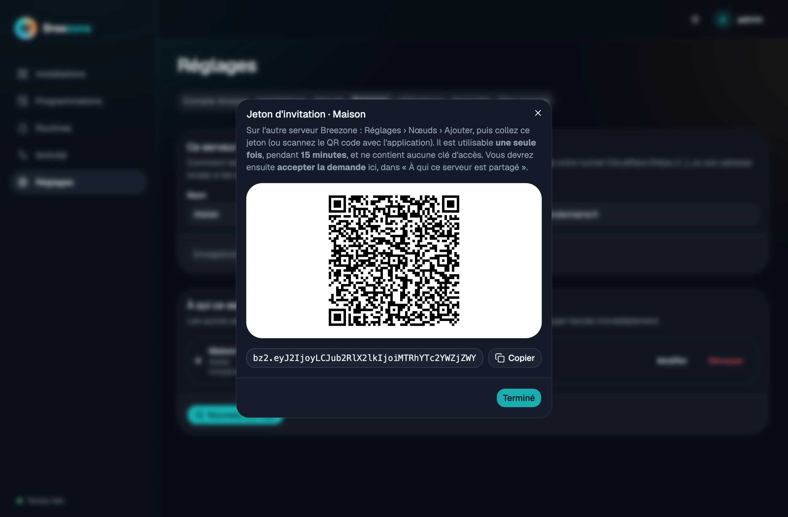
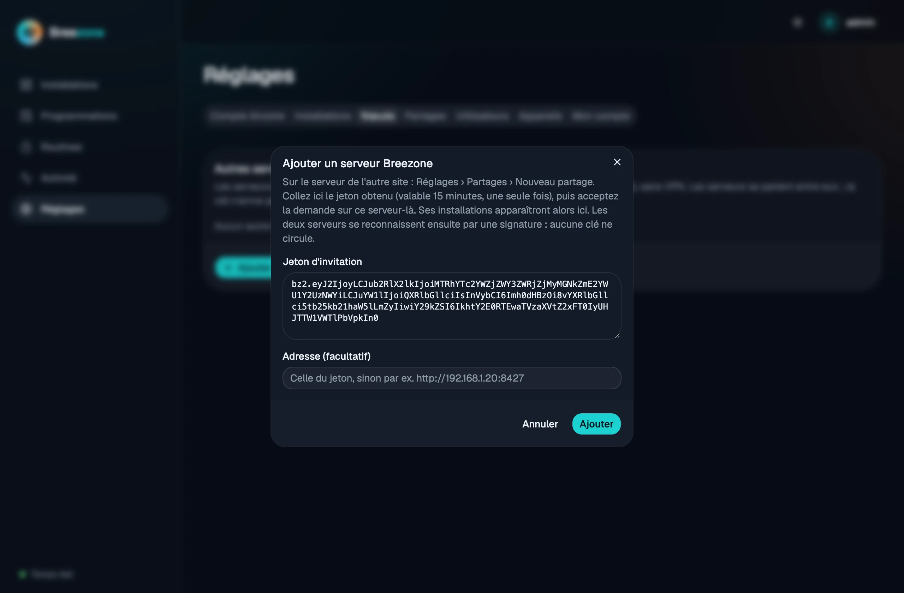
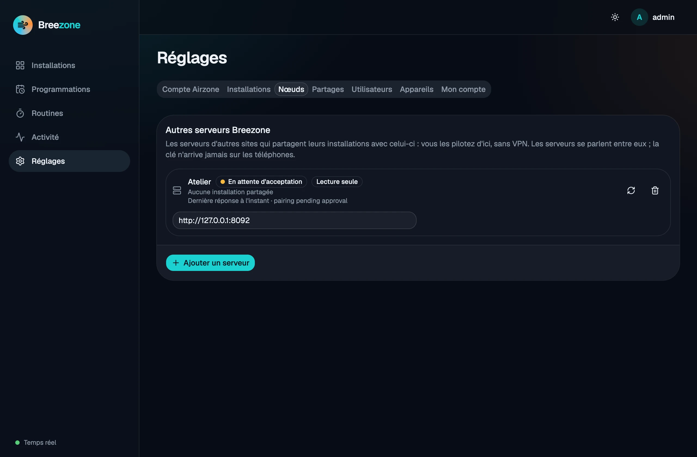
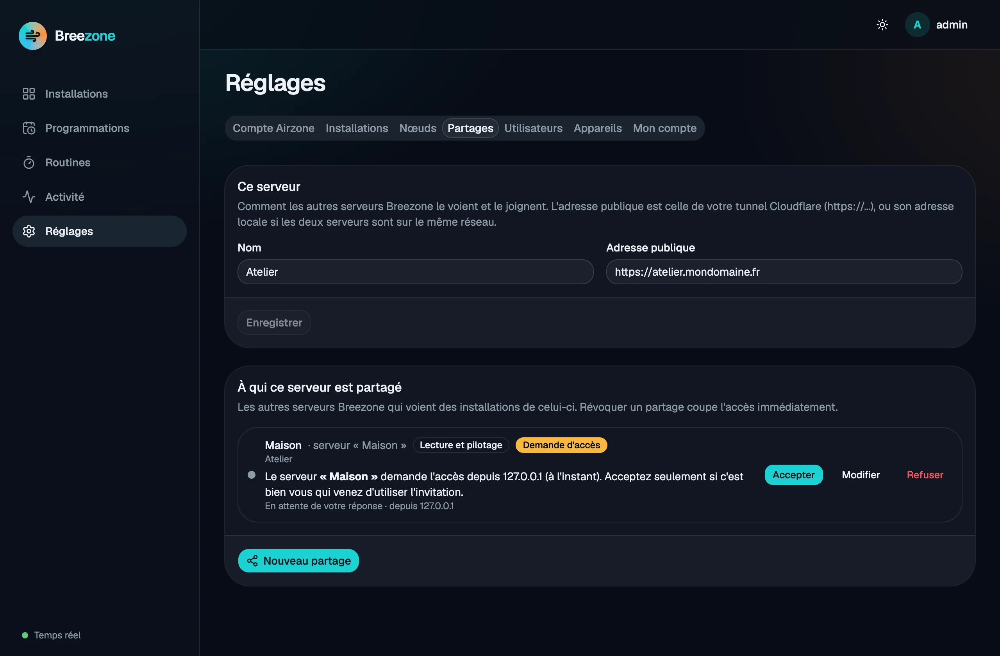
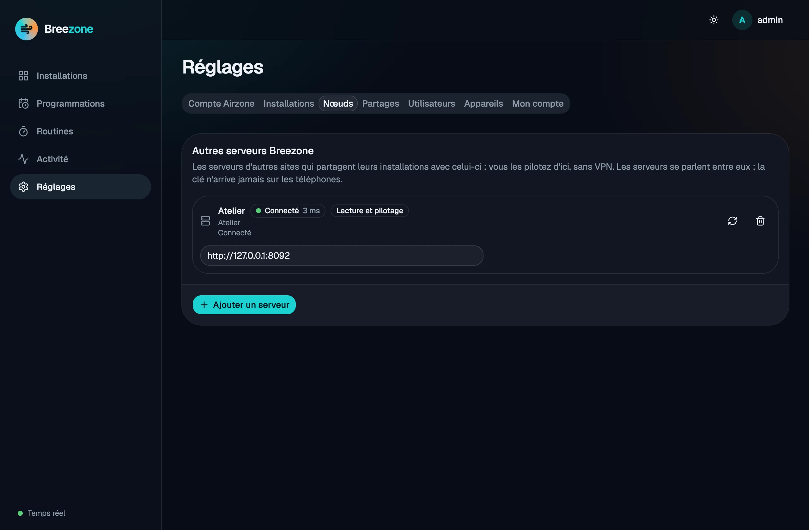
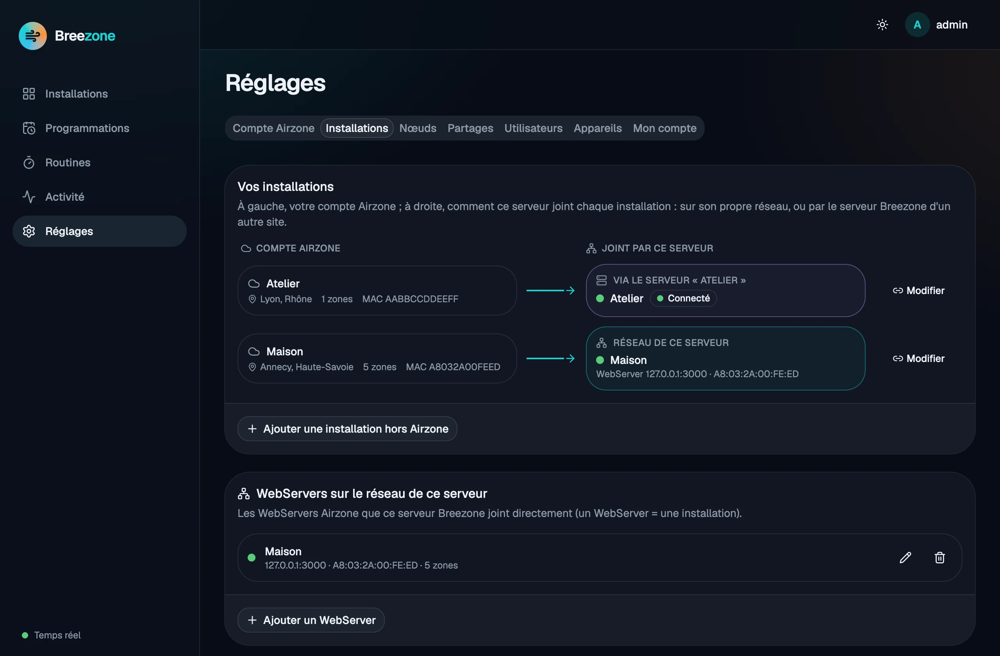

# Relier deux sites

Chaque site (maison, bureau, résidence secondaire…) a son propre serveur Breezone, qui pilote les
WebServers Airzone de son réseau. Un serveur peut **partager** certaines de ses installations avec un
autre : vous les voyez et les pilotez alors depuis l'autre site, sans VPN et sans ouvrir l'API des
WebServers.

Dans ce guide, le serveur **Atelier** partage son installation avec le serveur **Maison**.

## Avant de commencer

- Le serveur qui partage (Atelier) doit être joignable par l'autre : une adresse `https://` publique
  (proxy inversé du NAS ou Cloudflare Tunnel, voir le [guide Synology](install-synology.md#5-accès-depuis-lextérieur-facultatif)),
  ou son adresse locale si les deux serveurs sont sur le même réseau. HTTP n'est accepté que vers une
  adresse locale.
- Sur Atelier, renseignez cette adresse dans **Réglages › Partages › Ce serveur › Adresse publique**.
- Il faut être administrateur sur les deux serveurs.

## 1. Créer l'invitation (sur Atelier)

**Réglages › Partages › Nouveau partage** : nommez le serveur invité, choisissez les installations
partagées, le droit (**Lecture seule** ou **Lecture et pilotage**) et la durée de validité.

**Créer le jeton** affiche un jeton `bz2.…` et son QR code. Il est **à usage unique**, valable
**15 minutes**, et ne donne aucun accès par lui-même : il permet seulement de demander l'accès.

## 2. Ajouter le serveur (sur Maison)

**Réglages › Nœuds › Ajouter un serveur**, collez le jeton. Laissez **Adresse** vide pour utiliser
celle du jeton, ou indiquez-en une autre (par exemple l'adresse locale si les deux serveurs sont sur
le même réseau).

Le serveur apparaît **En attente d'acceptation** : Atelier a reçu la demande, mais n'a encore rien
partagé.

## 3. Accepter la demande (sur Atelier)

**Réglages › Partages** : le partage affiche **Demande d'accès**, avec le nom du serveur demandeur et
son adresse IP. Acceptez seulement si c'est bien vous qui venez d'utiliser l'invitation ; sinon,
**Refuser**.

## 4. C'est relié

Sur Maison, le nœud passe **Connecté** et ses installations apparaissent dans le tableau de bord, avec
la mention « via Atelier ».

Si vous avez connecté votre compte Airzone, **Réglages › Installations** montre pour chaque
installation du compte comment ce serveur la joint : sur son propre réseau, ou via un autre serveur
Breezone.

## Partage réciproque

Pour que **chaque site voie l'autre**, cochez **Partage réciproque** en créant l'invitation (étape 1).
En ajoutant le jeton (étape 2), l'autre serveur voit la proposition et choisit :

- **Partager aussi mes installations avec « Atelier »** : cochez les installations et le droit
  (lecture seule ou pilotage). Son adresse publique doit être renseignée (Réglages › Partages ›
  Ce serveur) ;
- ou décochez la case pour refuser : seul le partage d'Atelier vers Maison sera créé.

Quand Atelier accepte la demande (étape 3), la carte indique si Maison partage en retour, et Atelier
ajoute automatiquement Maison dans ses **Nœuds**. Chaque sens reste indépendant : chacun peut
révoquer le sien dans Réglages › Partages, ou retirer le nœud de l'autre.

## Certificat HTTPS non valide

Si l'autre serveur présente un certificat que la vérification HTTPS habituelle refuse (certificat
du NAS qui ne couvre pas le nom du proxy, certificat auto-signé, expiré…), Breezone affiche la raison
et le certificat : à qui il est délivré, les noms couverts, l'émetteur, les dates et l'**empreinte
SHA-256**.

- À l'ajout d'un serveur, le détail apparaît dans la boîte de dialogue, avec **Faire confiance à ce
  certificat**.
- Dans l'autre sens (partage réciproque) ou si le certificat d'un serveur déjà relié change, le
  nœud passe **Certificat refusé** dans Réglages › Nœuds : **Examiner le certificat**, puis faites-lui
  confiance.

Faire confiance **épingle ce certificat précis** : il est accepté quels que soient son nom et son
émetteur, mais tout autre certificat est refusé et Breezone redemande votre accord. Pour vérifier
que c'est bien le vôtre, comparez l'empreinte avec celle que votre navigateur affiche sur cette
adresse (cadenas › certificat). Une fois le certificat corrigé, **Rétablir la vérification
habituelle** revient au contrôle HTTPS normal.

La bonne solution reste un certificat valide : voir l'étape « Certificat » du
[guide Synology](install-synology.md#proxy-inversé-du-nas-https).

## Sécurité

- Le jeton ne contient aucune clé : une fois utilisé ou expiré, il ne sert plus à rien.
- Chaque serveur a sa propre clé Ed25519. Toutes les requêtes entre serveurs sont **signées** ; une
  requête rejouée, modifiée ou trop ancienne (plus de 5 minutes) est refusée.
- Le serveur qui partage ne voit que les installations cochées, avec le droit choisi. **Révoquer** le
  partage (Réglages › Partages) coupe l'accès immédiatement.
- Les téléphones ne reçoivent jamais ces clés : l'application parle seulement à son propre serveur.

## Problèmes fréquents

| Symptôme | Solution |
|----------|----------|
| « certificat HTTPS refusé : il ne couvre pas ce nom de domaine » | Le certificat de l'autre serveur ne correspond pas à son adresse (ex. certificat de `moncompte.synology.me` pour `breezone.moncompte.synology.me`) : corrigez-le (étape « Certificat » du [guide Synology](install-synology.md#proxy-inversé-du-nas-https)) ou faites-lui confiance (voir [Certificat HTTPS non valide](#certificat-https-non-valide)). |
| « certificat HTTPS différent de celui que vous aviez accepté » | Le certificat a changé (renouvellement, ou quelqu'un se fait passer pour le serveur) : examinez-le dans Réglages › Nœuds avant de lui faire confiance. |
| « nom de domaine introuvable » / « connexion refusée » | Vérifiez l'adresse publique de l'autre serveur, son DNS et la redirection du port 443 sur sa box. |
| « invitation expirée (15 minutes) » | Supprimez le partage sur Atelier et créez-en un nouveau. |
| « ancien format » à l'ajout | Le jeton vient d'une version 0.1 : mettez à jour Atelier et recréez l'invitation. |
| Le nœud reste « En attente d'acceptation » | Acceptez la demande dans Réglages › Partages sur Atelier. |
| Le nœud est connecté mais n'affiche aucune installation | Ce serveur joint déjà ce WebServer en direct (même adresse MAC) : l'installation reste pilotée localement. |
| « Révoqué » ou « Expiré » | Le partage a été supprimé ou est arrivé à échéance : demandez une nouvelle invitation. |
