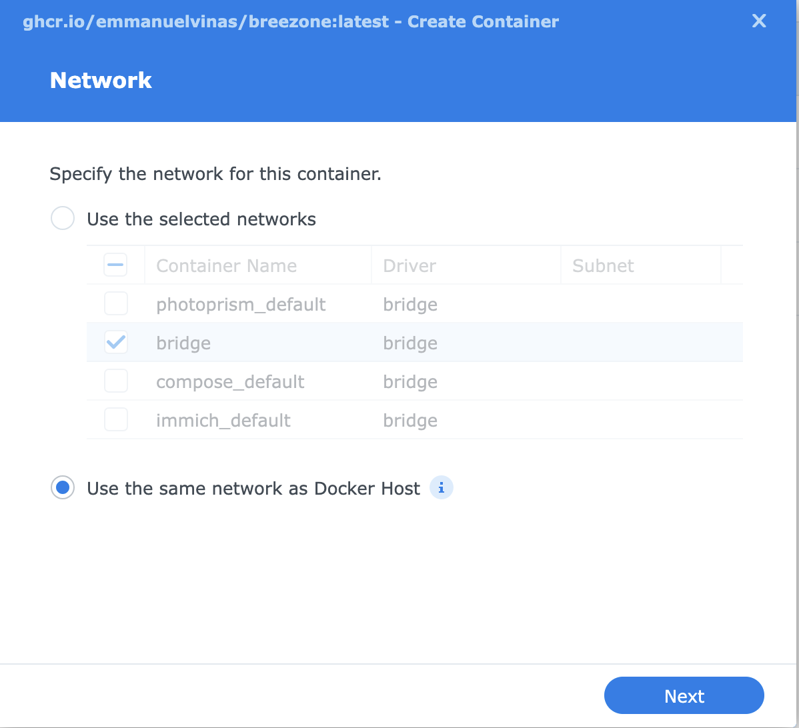
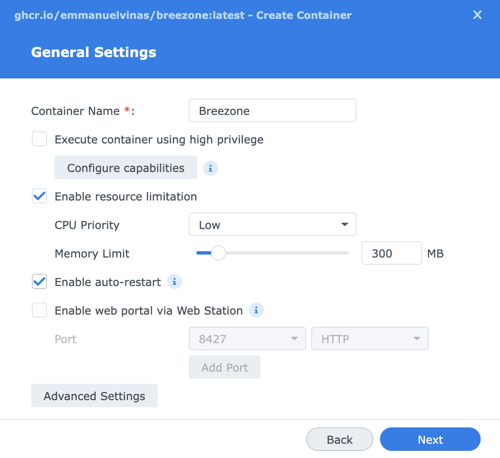
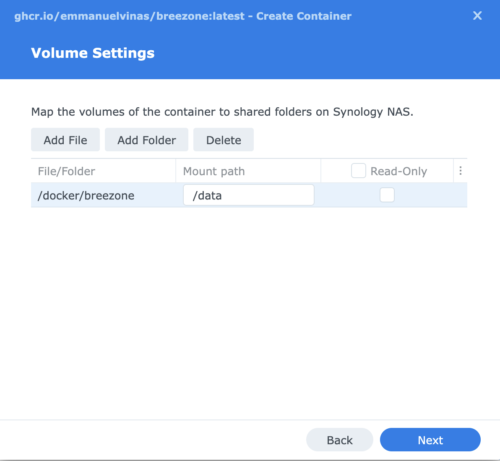
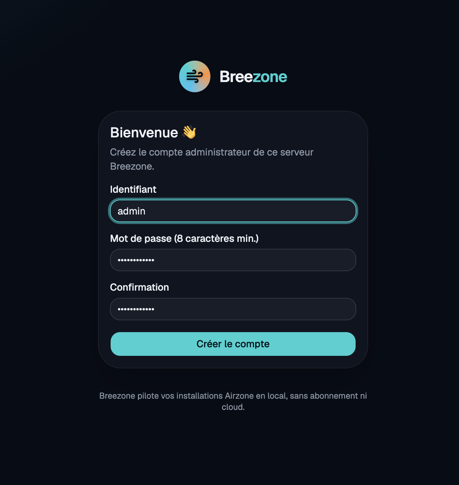
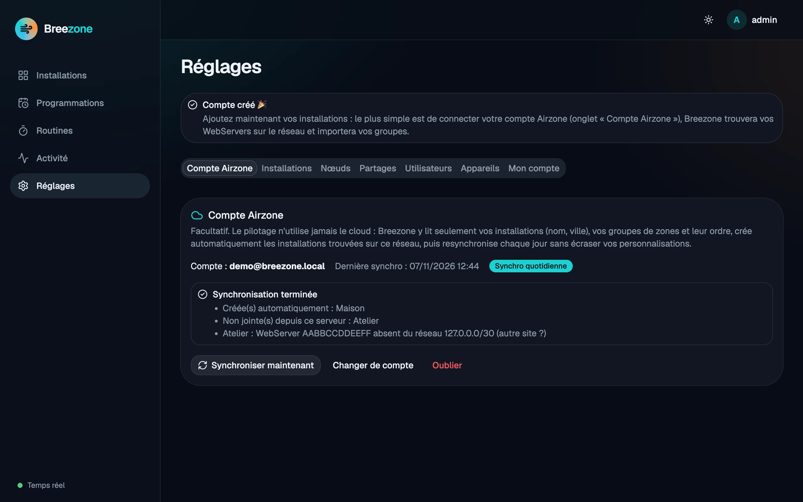

# Installer Breezone sur un NAS Synology

Breezone utilise quelques Mo de RAM : n'importe quel modèle compatible Docker convient (processeur
Intel, AMD ou ARM 64 bits). Deux cas :

- **DSM 7.2 ou plus récent**, paquet **Container Manager** : suivez les étapes 1 à 3.
- **Ancien paquet « Docker »** (DSM 6, DSM 7.0/7.1) : suivez l'étape 1, puis
  [l'étape 2 bis](#2-bis-avec-lancien-paquet-docker).

> **À savoir : n'utilisez pas l'onglet « Registre ».** Il ne sait chercher que sur Docker Hub et
> affiche « Registry returned bad result » avec GitHub Container Registry (`ghcr.io`), où Breezone
> est publié. Ce n'est pas nécessaire : le projet ci-dessous télécharge l'image tout seul.

## 1. Préparer

1. **Centre de paquets** › installez **Container Manager**.
2. **File Station** › dans le dossier partagé `docker` (créé par Container Manager), créez un dossier
   `breezone`.
3. Notez l'adresse IP du NAS (**Panneau de configuration › Réseau**), par exemple `192.168.1.20`.

## 2. Créer le projet

**Container Manager › Projet › Créer** :

- **Nom du projet** : `breezone`
- **Chemin** : `/docker/breezone`
- **Source** : *Créer un fichier docker-compose.yml*, puis collez :

```yaml
services:
  breezone:
    image: ghcr.io/emmanuelvinas/breezone:latest
    container_name: breezone
    restart: unless-stopped
    # Réseau de l'hôte : Breezone trouve tout seul les WebServers Airzone du réseau local.
    network_mode: host
    environment:
      TZ: Europe/Paris
      BREEZONE_PORT: "8427"    # changez-le si le port 8427 est déjà pris sur le NAS
    volumes:
      - breezone_data:/data
    mem_limit: 300m

volumes:
  breezone_data:
```

Cliquez sur **Suivant**, passez l'écran « Web Station », puis **Terminé** : Container Manager
télécharge l'image et démarre le conteneur (une minute environ).

## 2 bis. Avec l'ancien paquet « Docker »

Ce paquet ne sait pas télécharger une image depuis `ghcr.io` (« Invalid Docker Repository Url »,
« Failed to query registry ») : on la télécharge en ligne de commande, puis on crée le conteneur
dans l'interface.

**Télécharger l'image** sans SSH : **Panneau de configuration › Planificateur de tâches › Créer ›
Tâche déclenchée › Script défini par l'utilisateur**, utilisateur **root**, « Activé » décoché, avec
le script :

```bash
docker pull ghcr.io/emmanuelvinas/breezone:latest
```

Validez, sélectionnez la tâche et cliquez sur **Exécuter**. Après une minute, l'image apparaît dans
**Docker › Image**. (En SSH : `sudo docker pull ghcr.io/emmanuelvinas/breezone:latest`.)

**Créer le conteneur** : sélectionnez l'image puis **Launch**.

1. **Network** : choisissez **Use the same network as Docker Host**, pour que Breezone trouve tout
   seul les WebServers du réseau local.

   

2. **General Settings** :
   - **Container Name** : `breezone` ;
   - « Execute container using high privilege » : **décoché** ;
   - **Enable resource limitation** : CPU Priority `Low`, Memory Limit `300` Mo ;
   - **Enable auto-restart** : **coché** ;
   - « Enable web portal via Web Station » : décoché.

   

3. **Advanced Settings › Environment** : cliquez sur **Add** et ajoutez `TZ` = `Europe/Paris`. Ne
   touchez pas aux autres variables. Si la ligne `RUST_LOG` apparaît mal découpée (nom
   `RUST_LOG=info,tower_http=warn,sqlx`, valeur `warn`), supprimez-la : l'image applique déjà cette
   valeur. Si le port 8427 est déjà pris sur le NAS, ajoutez `BREEZONE_PORT` avec un autre port.

4. **Volume Settings** : **Add Folder**, choisissez (ou créez) le dossier `docker/breezone`, puis
   indiquez le chemin de montage **`/data`**, sans cocher « Read-Only ». **Ne sautez pas cette
   étape** : sans ce dossier, la base et les réglages sont perdus à chaque mise à jour.

   

   **Droits du dossier — indispensable.** Breezone ne tourne pas en root mais avec l'utilisateur
   `10001`, qui ne peut pas écrire dans un dossier créé avec File Station. Sans cette étape, le
   conteneur redémarre en boucle avec :

   ```text
   Error: error returned from database: (code: 14) unable to open database file
   ```

   Donnez le dossier à cet utilisateur, au choix :

   - **En SSH** (activez-le dans **Panneau de configuration › Terminal & SNMP**) :

     ```bash
     ssh votre-utilisateur@192.168.1.20
     sudo chown -R 10001:10001 /volume1/docker/breezone
     ```

   - **Sans SSH** : dans la tâche du Planificateur créée plus haut (utilisateur root), ajoutez la
     ligne `chown -R 10001:10001 /volume1/docker/breezone`, puis **Exécuter**.

   Remplacez `volume1` si le dossier partagé `docker` est sur un autre volume. Si l'erreur persiste
   (ACL Synology), dans **File Station**, clic droit sur `docker/breezone` › **Propriétés ›
   Autorisation › Créer** : **Everyone**, Autoriser, **Lecture** et **Écriture**, appliqué au
   dossier, aux sous-dossiers et aux fichiers.

   Si le conteneur a déjà été lancé, arrêtez-le, corrigez les droits, puis relancez-le.

5. **Next** jusqu'au résumé, cochez « Run this container after the wizard is finished », puis
   **Done**.

**Mettre à jour** : relancez la tâche du Planificateur (nouveau `docker pull`), puis dans
**Docker › Container**, arrêtez `breezone` et faites **Action › Clear** (« Reset » selon la
version) : le conteneur est recréé avec la nouvelle image. Les données restent dans
`docker/breezone`, à sauvegarder directement avec Hyper Backup.

## 3. Premier démarrage

Ouvrez `http://192.168.1.20:8427` (l'IP de votre NAS) :

1. créez le compte administrateur : choisissez un identifiant et un mot de passe d'au moins 8
   caractères. Cette page ne s'affiche qu'une fois, tant qu'aucun compte n'existe : faites-le dès
   l'installation, avant d'exposer Breezone sur Internet ;

   

2. connectez votre compte Airzone (facultatif) : Breezone retrouve vos WebServers sur le réseau
   par leur adresse MAC et importe les noms, la ville et les groupes de zones. Sinon, laissez-le
   rechercher les WebServers sur le réseau (*Réglages › Installations*).

   

Pour piloter un autre site depuis ce NAS, voir [Relier deux sites](federation.md).

Si la page ne s'ouvre pas : **Panneau de configuration › Sécurité › Pare-feu**, autorisez le port
`8427` (TCP) depuis votre réseau local.

## 4. Application mobile

Dans l'application, l'adresse du serveur est `http://192.168.1.20:8427` à la maison. Sur Android 17
et plus, acceptez l'autorisation « Appareils à proximité » (accès au réseau local) au premier
lancement.

## 5. Accès depuis l'extérieur (facultatif)

Deux solutions, sans ouvrir le port 3000 des WebServers (leur API n'a aucune authentification) :
le proxy inversé du NAS (HTTPS avec votre nom de domaine) ou un Cloudflare Tunnel (aucun port à
ouvrir sur la box).

### Proxy inversé du NAS (HTTPS)

**Panneau de configuration › Portail de connexion › Avancé › Proxy inversé › Créer.** La *source*
est l'adresse HTTPS tapée dans le navigateur ; la *destination* est Breezone, en HTTP sur le NAS.

Onglet **Général** :

| | Champ | Valeur |
|---|---|---|
| **Source** | Protocole | **HTTPS** |
| | Nom d'hôte | votre domaine, ex. `breezone.mondomaine.fr` ou `breezone.moncompte.synology.me` |
| | Port | **443** |
| | Activer HSTS | à cocher une fois que tout fonctionne |
| | Profil de contrôle d'accès | Non configuré (Breezone a ses propres comptes) |
| **Destination** | Protocole | **HTTP** |
| | Nom d'hôte | **localhost** |
| | Port | **8427** (ou la valeur de `BREEZONE_PORT`) |

Onglet **En-tête personnalisé** : **Créer › WebSocket**. Deux lignes doivent apparaître :

| Nom de l'en-tête | Valeur |
|---|---|
| `Upgrade` | `$http_upgrade` |
| `Connection` | `$connection_upgrade` |

**Indispensable** : sans ces en-têtes, le temps réel (WebSocket) ne passe pas. Le web affiche
alors « Reconnexion… » en permanence, l'application « Temps réel indisponible », et le journal d'activité de Breezone
indique « la demande de WebSocket est arrivée sans ses en-têtes ». Les données restent visibles
mais ne se mettent plus à jour en direct. L'onglet **Paramètres avancés** peut rester par défaut.

Pour vérifier depuis un ordinateur, la commande suivante doit afficher `HTTP 101` (et non 400) :

```bash
curl -s -o /dev/null -w 'HTTP %{http_code}\n' -m 5 --http1.1 \
  -H 'Connection: Upgrade' -H 'Upgrade: websocket' -H 'Sec-WebSocket-Version: 13' \
  -H 'Sec-WebSocket-Key: dGhlIHNhbXBsZSBub25jZQ==' https://breezone.mondomaine.fr/api/ws
```

Ensuite :

1. **Nom de domaine** : il doit pointer vers l'IP publique de votre box. Sans domaine, utilisez le
   DDNS Synology : **Panneau de configuration › Accès externe › DDNS › Ajouter** (ex.
   `moncompte.synology.me`).
2. **Box** : redirigez les ports **443** et **80** (TCP) vers l'IP du NAS. Le port 80 sert à
   Let's Encrypt pour délivrer et renouveler le certificat. **N'ouvrez pas le port 8427** : seul le
   443 doit être exposé.
3. **Certificat** : il doit couvrir **exactement** le nom de la source du proxy. Le certificat de
   `moncompte.synology.me` ne couvre **pas** `breezone.moncompte.synology.me`.
   **Panneau de configuration › Sécurité › Certificat › Ajouter › Ajouter un nouveau certificat ›
   Obtenir un certificat de Let's Encrypt** :
   - **Nom de domaine** : `moncompte.synology.me` (ou `mondomaine.fr`) ;
   - **E-mail** : le vôtre (avis d'expiration) ;
   - **Autre nom de l'objet** (*Subject Alternative Name*) : `breezone.moncompte.synology.me`
     (plusieurs noms séparés par `;`). N'y mettez pas `*.…` : un certificat générique ne peut pas
     être validé par ce formulaire.

   Let's Encrypt vérifie chaque nom par le port **80** : il doit être redirigé vers le NAS pendant
   la demande et les renouvellements.

   Puis **Paramètres** (ou **Configurer**) : en face de la ligne `breezone.…:443` (votre proxy
   inversé), choisissez ce certificat.
4. Ouvrez `https://breezone.mondomaine.fr` : le cadenas doit être valide, **sans** avertissement.
   Un autre serveur Breezone refuse toute adresse dont le certificat n'est pas valide.

Utilisez cette adresse dans l'application mobile hors de chez vous, et dans *Réglages › Partages ›
Ce serveur › Adresse publique* pour l'appairage avec un autre serveur Breezone (HTTP n'est accepté
qu'en réseau local).

### Cloudflare Tunnel

Sans ouvrir aucun port sur la box : ajoutez au projet le service `cloudflared` décrit dans le
[docker-compose.yml](../docker-compose.yml) du dépôt, avec le jeton de votre tunnel pointant vers
`http://localhost:8427`.

## 6. Mettre à jour

**Depuis l'interface web** (à partir de la 0.9.0) : **Réglages › Breezone › Mettre à jour**, réservé
aux administrateurs. Breezone télécharge la nouvelle version depuis son dépôt officiel, vérifie sa
signature, sauvegarde la base dans `backups/` du volume, puis redémarre dessus en quelques secondes.
Si elle ne démarre pas, Breezone revient seul à la version précédente. La version affichée par
Container Manager reste celle de l'image : la vraie version est dans les réglages de Breezone.
Pour retirer ce bouton : `BREEZONE_SELF_UPDATE=false` dans `.env`.

Cela ne met à jour que Breezone. Pour mettre aussi à jour le système de l'image (de temps en temps) :

**Container Manager › Projet › breezone › Action › Arrêter**, puis **Action › Construire** : l'image
`latest` est téléchargée à nouveau et le conteneur recréé. Les données sont conservées dans le
volume `breezone_data`.

Ou en SSH : `cd /volume1/docker/breezone && sudo docker compose pull && sudo docker compose up -d`.

Pour rester sur une version précise, remplacez `latest` par son numéro (ex. `0.9.0`).

## 7. Sauvegarder

Les données (base SQLite, secret de signature) sont dans le volume `breezone_data`. En SSH :

```bash
sudo docker run --rm -v breezone_breezone_data:/data -v /volume1/docker/breezone:/backup \
  alpine tar czf /backup/breezone-backup.tgz -C /data .
```

Le fichier `breezone-backup.tgz` du dossier `docker/breezone` peut ensuite être sauvegardé avec
Hyper Backup.

## Problèmes fréquents

| Symptôme | Solution |
|----------|----------|
| « Registry returned bad result » | Normal avec `ghcr.io` : n'utilisez pas l'onglet Registre, créez le projet (étape 2). |
| « Invalid Docker Repository Url » ou « Failed to query registry » (ancien paquet Docker) | Téléchargez l'image avec `docker pull` (étape 2 bis). |
| Le téléchargement de l'image échoue (`denied`, `unauthorized`) | L'image n'est pas encore publique, ou le nom est mal saisi : `ghcr.io/emmanuelvinas/breezone` (en minuscules). |
| Le conteneur redémarre en boucle, « address already in use » | Le port 8427 est pris : changez `BREEZONE_PORT` (ex. `8099`). |
| Le conteneur redémarre en boucle, « (code: 14) unable to open database file » | Le dossier monté sur `/data` n'est pas accessible en écriture : `sudo chown -R 10001:10001 /volume1/docker/breezone` en SSH (étape 2 bis, « Droits du dossier »). |
| « Temps réel indisponible » (app) ou « Reconnexion… » permanent (web) | Le proxy inversé ne transmet pas le WebSocket : ajoutez les en-têtes `Upgrade` et `Connection` (section 5, onglet En-tête personnalisé). |
| Ajout d'un serveur : « certificat HTTPS refusé : il ne couvre pas ce nom de domaine » | Le certificat du NAS ne couvre pas le nom du proxy inversé : voir l'étape « Certificat » de la section 5. |
| Aucun WebServer trouvé | Vérifiez `network_mode: host` ; sinon indiquez le réseau dans *Réglages › Installations* (ex. `192.168.1.0/24`) ou l'adresse IP du WebServer. |
| L'application Android affiche une erreur de réseau local | Autorisez « Appareils à proximité » dans *Paramètres › Applications › Breezone › Autorisations*. |
